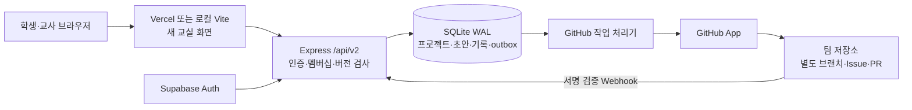

# VPyLab 새 교실 구조와 운영 전환 기준

작성일: 2026-10-28. 현재 단계는 `codex/classroom-v2` 브랜치의 로컬 검증입니다. 사용자의 수업 테스트와 명시적인 운영 교체 승인 전에는 기존 서비스로 배포하거나 운영 데이터 이관을 실행하지 않습니다.

## 무엇을 보존하고 무엇을 새로 만들었는가

기존 코스·차시·미션·예제·API 문서 파일을 새 교실에서도 그대로 읽습니다. 자료의 코드뿐 아니라 문제 정의와 출처를 프로젝트의 시작점으로 사용합니다. `source={kind,id,title,courseId?}`를 저장하여 어떤 자료에서 시작했는지 추적합니다. 콘텐츠 원문을 새 DB에 덮어쓰지 않습니다.

기존 프론트 진입점, 기존 Express API, 기존 Supabase 데이터와 SQL 정책은 운영 상태를 유지합니다. 새 교실은 별도 `classroom.html`, `/api/v2`, SQLite 파일을 사용합니다. 공용 Python 실행 엔진의 안정성 보완은 기존 앱과 새 교실이 함께 사용하므로 기존 앱 회귀 검증도 필요합니다.

## 실제 저장 구조

**현재 새 도메인의 영속 원본은 SQLite입니다. Supabase는 운영 로그인, GitHub는 PR과 배포 버전의 근거를 담당합니다.** GitHub만으로 개인 초안·학습 기록·권한·교사 피드백까지 복구할 수 있는 구조는 아닙니다.



| 데이터 | 현재 보관 위치 | 의미 |
|---|---|---|
| 로그인 신원·교사 임명 | Supabase Auth | 검증된 사용자 ID와 관리자 지정 역할 |
| 프로젝트·멤버십·AI 정책·수업자료 출처 | SQLite | 접근 권한과 수업 조건의 원본 |
| 개인 초안 | SQLite | 사용자·프로젝트·편집 창별 복구본 |
| 팀 확정 코드·버전별 이력 | SQLite | 충돌 검사를 거친 팀 작업 기록 |
| 질문·제안·검토·성찰·교사 피드백 | SQLite | 문제 해결과 평가의 근거 |
| 요청 재시도 결과·GitHub 대기 작업 | SQLite | 응답 유실과 외부 장애에서 복구할 상태 |
| 검토용 코드 브랜치·PR·배포 기준 커밋 | GitHub | 동료 검토와 배포에 사용할 코드 버전 |
| 코스·미션·예제·문서 | 기존 저장소 파일 | 수정하지 않은 수업자료 원문 |

SQLite에는 `WAL`, 외래 키 검사, 쓰기 트랜잭션을 적용합니다. 서버와 GitHub 처리기는 같은 영속 DB를 사용합니다. 초기 운영 배치는 **한 서버 프로세스와 한 쓰기 주체**를 기준으로 합니다. Railway에서 실행하려면 영속 volume을 마운트하고 `CLASSROOM_DB_PATH`를 그 안의 파일로 지정해야 합니다. 여러 복제본이나 임시 파일시스템에 DB를 나누어 두는 배치는 지원하지 않습니다. volume 설정은 [Railway 공식 문서](https://docs.railway.com/volumes/reference)를 기준으로 실제 staging에서 검증해야 합니다.

Vercel은 프론트를 제공하고 `/api/v2` 요청을 백엔드로 전달합니다. SQLite를 Vercel 함수의 임시 디스크에 두지 않습니다. 여러 서버로 확대하려면 먼저 저장소 인터페이스와 버전 검사를 유지하는 PostgreSQL 등의 이관 설계를 검증해야 합니다.

## 인증과 프로젝트 범위

로컬 데모는 `CLASSROOM_MODE=local` 또는 `CLASSROOM_LOCAL_MODE=1`을 명시했을 때만 열립니다. 서버는 loopback으로만 바인딩하고 Host도 localhost 주소인지 검사합니다. 선생님·학생 가·학생 나의 미리 정한 계정만 선택할 수 있습니다. 무작위 세션 ID를 HttpOnly·SameSite 쿠키에 저장합니다. 이 데모 모드를 외부 학급 로그인으로 사용하지 않습니다.

운영 모드는 Supabase access token을 `Authorization: Bearer ...`로 받고 `auth.getUser()`로 검증합니다. 서버에는 `SUPABASE_URL`, `SUPABASE_ANON_KEY`가 필요합니다. 교사는 운영자가 Supabase Admin 경로에서 `app_metadata.classroom_role='teacher'`로 임명해야 합니다. 사용자가 수정하는 프로필이나 요청의 role·userId 헤더로 교사를 임명하지 않습니다.

교사도 프로젝트 소유자이거나 멤버일 때만 프로젝트를 읽고 관리할 수 있습니다. 교사 현황은 참여한 프로젝트만 집계합니다. 학생이 만든 프로젝트에 교사가 피드백하려면 먼저 초대 코드로 참여해야 합니다. 현재 범위는 **프로젝트 멤버십**이며, 전체 학교·학급 조직 모델이나 학교 전체 관리자 권한을 구현했다고 보지 않습니다.

교사 기록의 공개 범위는 `private`(작성 교사만), `student`(대상 학생과 참여 교사), `team`(팀 전체)입니다. 새 근거 연결 양식은 기본적으로 교사 개인 기록을 선택합니다. 이 범위는 상세 조회·학생별 요약·교사 현황·프로젝트 내보내기에 동일하게 적용됩니다. 기존 개별 피드백은 `student`, 기존 팀 피드백은 `team`으로 이관합니다.

변경 요청은 허용된 Origin에서만 받습니다. `X-Classroom-User`는 인증 수단이 아니라 화면이 기대한 계정과 실제 세션의 불일치를 찾는 보조 장치입니다. 계정 전환 후 도착한 이전 화면의 조회·내보내기·쓰기 요청을 모두 거부하고, 화면은 이전 계정의 작업을 즉시 닫아 실제 세션과 다시 동기화합니다. 관찰자(viewer)는 읽기만 할 수 있습니다.

## 작업 보존과 협업 규칙

1. 개인 초안은 팀 확정 코드를 바꾸지 않습니다. 계정·프로젝트·편집 창별로 저장하고 순서가 뒤집힌 요청이 최신 초안을 덮어쓰지 못하게 합니다. 새 창에 정확한 초안이 없으면 본인·해당 프로젝트의 이전 초안을 복제해 복구하며 원본 창의 기록은 유지합니다. 기록 화면에서 본인의 서버 초안 최신 20개도 선택할 수 있습니다.
2. 확정 저장에는 `baseVersion`이 필요합니다. 다른 팀원이 먼저 저장하면 409와 최신 저장본을 반환하여 비교하도록 합니다. 자동으로 강제 덮어쓰지 않습니다.
3. 코드·이력·outbox는 같은 트랜잭션에서 저장합니다. 일부만 저장된 상태를 성공으로 반환하지 않습니다.
4. core 변경 API에 `Idempotency-Key`를 보내면 계정·HTTP 메서드·경로·정규화된 요청 내용과 최초 응답을 함께 저장합니다. 같은 작업의 재시도는 최초 응답을 재생하고 다른 내용으로 키를 재사용하면 409를 반환합니다. 키 없는 호출에는 이 재시도 보장을 적용하지 않습니다.
5. 제안은 다른 팀원의 검토를 받습니다. 본인 검토를 막고, 승인한 사람이 관찰자로 바뀌면 그 승인은 반영 권한으로 사용하지 않습니다. 교사는 참여 프로젝트에서 반영할 수 있습니다.
6. 제안 반영에도 최신 버전 검사를 적용합니다. 코드와 성찰의 원저자는 제안자로 남기며 실제 반영자는 `mergedBy`에 따로 기록합니다.
7. 사용자 코드와 증거는 허용 크기를 넘으면 저장 전에 거부합니다. 코드는 UTF-8 기준 50KB입니다. 화면 출력은 React의 텍스트 렌더링을 사용합니다.

프론트가 응답을 받지 못했다면 같은 요청 키로 다시 확인해야 합니다. 단순히 최신 코드를 다시 제출하거나 새 키를 매번 발급하면 최초 성공 여부를 판정할 수 없습니다. 이 키와 응답 기록도 SQLite 백업에 포함됩니다.

## GitHub 연결의 역할과 한계

로컬 기본값은 **모의 저장소**입니다. 실제 GitHub에 접속하거나 PR을 게시하지 않고 외부 커밋·기준 SHA 충돌·제안 흐름을 시험합니다.

운영 연결은 GitHub App과 서버에 등록한 저장소 목록을 사용합니다. 저장소 식별자·설치 ID·프로젝트 범위를 확인하며 학생 프로젝트는 비공개 저장소를 기본으로 합니다. 설치 토큰이나 App 개인 키를 브라우저에 전달하지 않습니다.

팀 저장본을 저장했다고 GitHub main을 바로 바꾸지 않습니다. 사용자가 명시한 GitHub 제안은 별도 브랜치와 PR로 보냅니다. GitHub 최신 코드를 가져오는 동작은 비교본을 갱신하며, 편집 중인 코드나 팀 확정 코드를 자동으로 덮어쓰지 않습니다. GitHub 기준 SHA가 달라지면 작업을 중단하고 비교를 요구합니다.

API 제한·통신 장애·권한 회수는 outbox 상태로 남습니다. 로컬 도메인 저장은 계속됩니다. Webhook은 원본 본문의 HMAC 서명과 전송 ID를 확인하고 연결된 설치·저장소·브랜치에만 반영합니다. 복구용 DB를 staging에서 열 때는 GitHub를 offline으로 설정하여 복구된 pending 작업이 실제 저장소로 전송되지 않게 해야 합니다.

실제 GitHub App 설치·토큰 권한·Webhook·비공개 저장소·PR 승인과 배포는 staging 실계정 검증이 남아 있습니다. 모의 저장소와 어댑터 테스트 통과가 실운영 연동 완료를 뜻하지 않습니다.

GitHub의 이슈·PR·리뷰·댓글·커밋은 별도의 불변 과정 기록으로 추적합니다. Webhook으로 수신하고 제한된 읽기 전용 REST 수집으로 보완합니다. 학생 귀속은 검증한 숫자 GitHub ID 또는 인증된 VPyLab 제출 요청에 근거하며, 두 역할을 구분합니다. 교사는 원문 근거와 연결한 개인 관찰·학생 피드백을 남깁니다. 이 기록은 GitHub에 게시하지 않습니다. 수집 범위와 누락 가능성을 표시하고 기록 횟수로 능력·성적을 자동 판정하지 않습니다. 상세 계약은 [GitHub 연결 문서](classroom-github.md#과정-기록과-학생-피드백)를 참고합니다.

## 소리의 실행 수명

새 교실은 음량·음소거와 피아노·뮤직박스 미리 듣기를 제공합니다. 미리 듣기는 사용자가 눌렀을 때만 연주합니다. 모든 수업 소리는 공통 출력 gain·compressor·soft limiter를 거치며 짧은 attack/release로 갑작스러운 시작·중단을 완화합니다. 동시 소스와 예약 수를 제한하고 자연 종료한 노드를 정리합니다. 장치의 실제 출력 음량이나 주관적인 음질을 자동 테스트로 보장하지는 않습니다.

정상적인 Python 반환 후에는 예약된 단발음·유한 시퀀스의 잔향을 허용합니다. 사용자가 정지하거나 오류·다음 실행·프로젝트 이탈이 발생하면 예약과 소스를 정리합니다. 기존 수업의 sound API와 파형 선택은 유지하고 추가 음색을 사용할 수 있습니다.

## AI를 사용하는 수업과 사용하지 않는 수업

`aiPolicy='optional'|'disabled'`를 프로젝트에 저장하며 소유자와 참여 교사가 설정합니다. AI를 사용하지 않는 수업도 문제 정의 → 가설 → 제작·실험 → 관찰 → 동료 검토 → 다음 실험 → 교사 피드백으로 완결됩니다.

공통 평가는 문제 정의·실험·추론·협업·다음 계획에 대한 서술 근거를 사용합니다. AI 사용 여부로 점수를 더하거나 빼지 않습니다. AI 사용 기록은 선택 항목이며 공통 실험 증거를 대신하지 않습니다. 현재 정책은 수업 화면과 기록의 정책이며 학생의 외부 AI 도구 사용을 기술적으로 통제한다고 주장하지 않습니다.

현재 새 교실의 AI 선택 수업은 AI 도구에서 얻은 제안과 학생의 검증·판단을 기록하는 방식입니다. 새 화면에 내장 AI 채팅이나 AI 자동 평가는 연결하지 않았습니다.

## 로컬 실행과 확인

```sh
npm run dev:classroom
```

새 화면은 `http://127.0.0.1:4043/classroom.html`, 새 서버는 4044, 기본 DB는 `.local/classroom-v2.sqlite`입니다. 실제 설정은 `.env.classroom.local` 또는 `CLASSROOM_ENV_FILE`로 지정한 새 교실 전용 파일을 사용합니다. 기존 `.env`를 새 서버 설정으로 자동 재사용하지 않습니다.

`GET /api/v2/health`는 프로세스 응답 여부를 확인합니다. `GET /api/v2/readiness`는 DB 테이블을 실제로 읽고 프로젝트 코드와 최신 이력이 일치하는지, 운영 인증 설정이 존재하는지를 확인합니다. readiness는 전체 디스크 무결성·남은 용량·실제 Supabase 통신·GitHub 권한까지 증명하지 않습니다. 전체 DB 검증은 아래 백업 검사로 수행합니다.

```sh
npm run test:classroom
node --test scripts/classroom/backup.test.mjs
npm run build:classroom
```

기존 앱 테스트·빌드·린트와 새 교실 테스트, 수업자료 원본 보존 검사도 교체 전 검증에 포함합니다. 자동 테스트 결과와 사용자의 실제 수업 사용 검증을 구분합니다.

## 일관된 백업과 임시 복구 리허설

백업 도구는 `node:sqlite.backup`을 사용합니다. WAL에만 남아 있는 커밋도 포함한 일관된 DB를 생성하며 원본을 읽기 전용으로 엽니다. `cp classroom.sqlite` 한 파일을 실행 중에 복사하는 방식은 사용하지 않습니다. 도구에는 Node.js 22.16 이상이 필요합니다. API의 지원 버전과 동작은 [Node.js 공식 문서](https://nodejs.org/api/sqlite.html#sqlitebackupsource-db-path-options), 일관된 백업 원리는 [SQLite 공식 문서](https://sqlite.org/backup.html)를 참고합니다.

```sh
node scripts/classroom/backup.mjs snapshot --db .local/classroom-v2.sqlite --out .local/backups/classroom-2026-10-28.sqlite
node scripts/classroom/backup.mjs verify --db .local/backups/classroom-2026-10-28.sqlite
node scripts/classroom/backup.mjs rehearse --db .local/classroom-v2.sqlite
```

`snapshot`은 기존 목적지를 덮어쓰지 않습니다. 임시 파일에 백업을 완료한 뒤 무결성·외래 키·코드/이력 버전을 검사하고, 읽기 권한을 소유자에게만 허용한 파일과 SHA-256 manifest를 남깁니다. 검사 실패는 정상 백업으로 승인하지 않습니다. `verify`는 [SQLite 무결성 검사](https://sqlite.org/pragma.html#pragma_integrity_check), 도메인 일치, manifest 해시를 확인합니다.

`rehearse`는 시스템 임시 폴더에서 백업 → 새 파일 복구 → 쓰기 트랜잭션과 rollback → 재오픈을 수행합니다. 내용 지문이 같은지 확인한 뒤 임시 폴더를 정리합니다. 원본 DB·운영 경로를 바꾸거나 GitHub 작업을 실행하지 않습니다. 이 명령은 실제 운영 파일을 덮어쓰는 restore 명령이 아닙니다.

수업 전후와 운영 변경 전 백업, 별도 저장소로의 암호화 보관, 보관 기간, 복구 담당자와 허용 손실 시간은 운영 승인 전에 정해야 합니다. 현재 자동 백업 스케줄·원격 업로드·백업 알림을 설정하지 않았습니다. 같은 volume에 있는 사본만으로 volume 장애를 복구할 수 있다고 보지 않습니다. 백업에는 학생 코드·피드백·초안·로컬 세션이 있으므로 공개 저장소에 커밋하지 않습니다.

## 사용자 승인 후 운영 교체 절차

1. **로컬 사용 승인**: 기존 자료에서 프로젝트 생성, AI 미사용 수업, 학생 간 충돌, 초안 복구, 검토·반영·교사 피드백, 수업자료 보존을 사용자가 확인합니다. 이 승인을 받기 전 배포 경로를 바꾸지 않습니다.
2. **staging 준비**: 별도 서비스·영속 volume·DB 경로·프론트 주소를 사용합니다. 데모 로그인을 끄고 Supabase 로그인과 교사 임명, 프로젝트별 권한을 실계정으로 확인합니다. GitHub는 먼저 offline으로 시작하고 허용 저장소를 설정한 뒤 별도 연동 검증을 합니다.
3. **이관 시범**: 기존 Supabase 데이터를 읽기 전용으로 export하고 별도 staging DB로 변환합니다. 사용자 ID·소유자·팀 멤버·프로젝트 코드·원본 출처를 대조합니다. 기존 데이터에 없는 버전 이력이나 성찰을 만들어 넣지 않습니다. 현재 브랜치가 기존 Supabase 데이터를 자동 이관하는 도구를 제공한다고 보지 않습니다.
4. **복구 리허설과 기준 합의**: staging에서 백업·복구·재시작, 데이터 건수·코드 지문·권한·outbox를 확인합니다. 학교 공용 IP와 예상 동시 접속 인원의 부하, 실행 중단·계정 전환·망 단절도 검증합니다. RPO/RTO와 중단 시간을 실측 후 합의합니다.
5. **최종 교체 승인**: 코드 커밋, 이관 매핑·검증 결과, DB 백업 위치, 실제 GitHub 권한, 되돌릴 프론트/서버 버전을 사용자가 검토하고 승인합니다. 그때 수업 쓰기를 잠시 멈추고 최종 export·백업 후 승인한 새 DB로 이관합니다.
6. **교체와 관찰**: 새 배포를 승인한 DB 경로에 연결하고 readiness·로그인·프로젝트 범위·샘플 저장·복구를 확인합니다. 대기 중 GitHub 작업을 검토한 후 외부 전송을 허용합니다. 기존 Supabase와 이전 배포는 즉시 삭제하지 않습니다.

실제 복구가 필요하면 먼저 서버와 처리기를 정상 종료하여 쓰기를 멈춥니다. 검증한 백업을 **새 복구 경로**에 복원하고 검사한 뒤 `CLASSROOM_DB_PATH`를 그 파일로 바꾸어 재시작합니다. 열려 있는 DB의 본 파일이나 WAL/SHM 파일을 개별 삭제·교체하지 않습니다. 기존 DB와 부속 파일은 조사와 재시도를 위해 보존합니다.

되돌리기는 이전 프론트/서버 경로 복구와 데이터 보존을 함께 계획해야 합니다. 새 교실에서 생긴 코드·초안·피드백을 포함한 DB를 백업하고 새 쓰기를 멈춘 뒤 전환합니다. 새 스키마의 작업을 이전 Supabase 스키마로 되돌리는 변환은 아직 구현하지 않았으므로, 새 DB를 보존하고 프로젝트 export를 확보한 상태에서 별도 대조·병합을 수행해야 합니다. 경로만 되돌리면서 새 작업을 버리지 않습니다.
