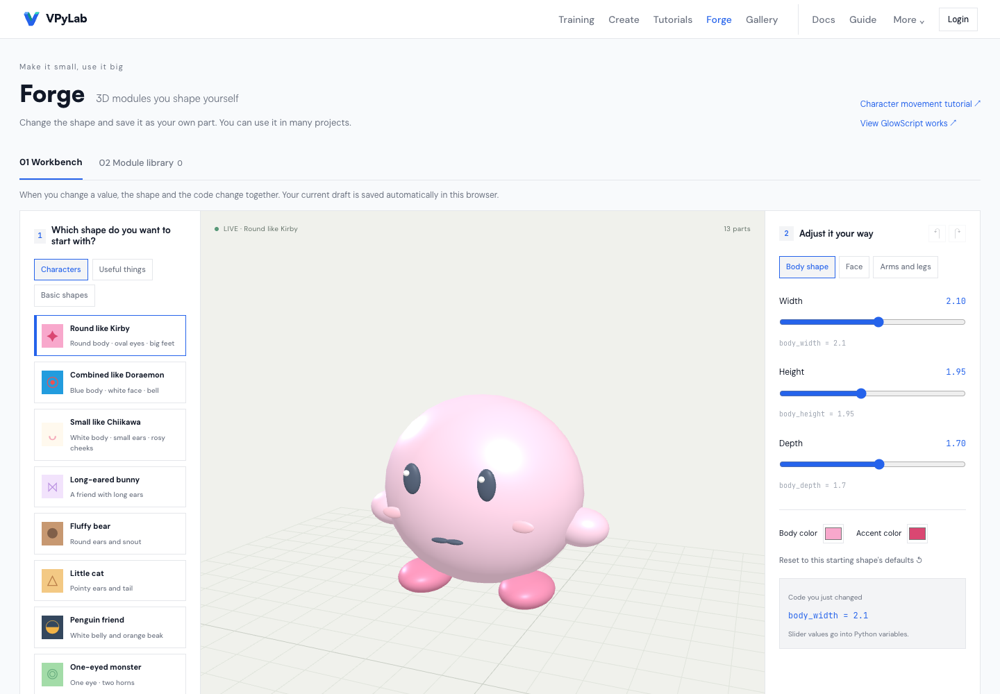
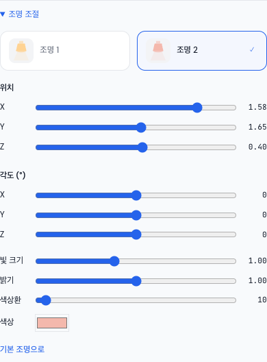

# 영문판·조명 선택 최종 점검 — 2026-11-07

## 반영한 것

- 조명 1·2 선택을 각 조명의 색·선택 체크가 보이는 두 카드로 변경했습니다. 조절 패널은 처음에는 접혀 있고 각 조명의 슬라이더 값은 따로 보관합니다.
- 영어 메뉴·만들기·대장간·모듈 보관함·저장/복원·팀·공개 안내·문서 주변 UI·사용 안내를 보완했습니다. 고정 UI/교재 번역 사전은 1,663개 항목입니다. 실제 화면 사용 개수와 동일하다는 뜻은 아닙니다.
- 기초 빛과 소리 8차시와 GitHub 4차시의 전체 안내·단계·과제·힌트를 영어로 제공합니다. 기존 한국어·영어 미션/문서/튜토리얼 데이터와 연결합니다. 기본 예제 목록의 제목·설명도 영어로 제공합니다.
- `?lang=en` / `?lang=ko`로 바로 열고 언어를 브라우저에 기억합니다. 언어 선택과 `html.lang`을 함께 바꿉니다.
- 학생이 만든 제목·설명·이름·코드·출력, 원본 GlowScript 33개와 원본 폴더명은 보존합니다. 영어 교재는 서비스가 제공한 초기 사본만 바꾸고 이미 수정한 초안을 덮지 않습니다.

## 실제 결함과 수정

1. **공유 코드를 수정한 뒤 언어 변경 시 덮어쓰기**: 번역 함수 `t`가 바뀌면서 공유 소스 효과가 다시 실행됐습니다. 최신 번역은 ref로 읽고, 소스 효과에서 `t` 의존성을 제거했습니다. 일반 공유 상태와 구형 해시 소스 모두 `location.key`별 한 번만 반영합니다. 실제 Monaco의 공유 상태·base64 링크 경로에서 수정 내용과 실행 횟수를 확인했습니다.
2. **영문 소리의 대기 의미 차이**: 원래 `play_note()`는 즉시 반환하고 `음표()`는 재생 시간만큼 기다립니다. 초기 영문 사본에서 단순 치환하면 멜로디·색 전환이 달라질 수 있어, 기존 계약을 유지하고 **VPyLab 확장 `play_note_and_wait`**를 기존 async `음표`의 별칭으로 추가했습니다. Worker·변환기와 서버 패키지 사본·공유 HTML·문서·자동 완성에 연결했습니다. 기초 영어 교재는 대기형 도우미를 사용합니다. 실제 Pyodide에서 0.5초 음 동안 노란색을 유지하고 그 뒤 파란색으로 돌아왔습니다.
3. **영문 교재 용어 변환**: 실행 코드에서는 주석·문자열·식별자를 나눠 처리하며, 일반 문자열·변수·원래 비대기 `play_note()`를 보존합니다. 도4·솔#5·레b3·도-1 등 옥타브/변화음을 각각 C4·G#5·Db3·C-1로 맞춥니다. 학생 프로젝트 코드는 변환 대상이 아닙니다.
4. 학습 단계의 **Check**와 대화상자의 **OK**를 구분하고 문구 사이 공백, 저장 이력의 상대 시간, 공개 모달 언어 전환도 보완했습니다. 번역 사전은 상속된 객체 키를 읽지 않도록 했습니다.
5. 자동 완성에서 box1 변수가 있을 때 box의 뜻 카드가 선택창을 닫지 않게 했고, 긴 이름 중간을 수정할 때 짧은 단어의 카드를 띄우지 않게 했습니다.

## Claude·Gemini 검토

3-way 스킬과 기존 전체 소스 검토 승인 범위에서 비밀값·학생 실제 자료를 제외한 읽기 전용 사본을 사용했습니다. 런타임에는 AI 호출을 추가하지 않았습니다.

- **Claude**: 고정 UI 480개와 교재 180개 번역, 구현 검토에서 공유 소스 덮어쓰기·Check/OK·공백·소리 용어/대기 검증을 지적했습니다. 반영 후 정적 재검토에서 제공된 범위의 P1/P2가 남지 않았다고 응답했습니다. 실제 실행 확인은 호스트가 별도로 수행했습니다.
- **Gemini 4 Argon**: 고정 UI 411개·교재 259개·추가 예제/오류 330개 번역을 제공했습니다. 소스 열람형 최종 검토 두 건은 브리지의 “응답이 비어 있거나 길이 제한을 넘었습니다” 오류로 유효한 결론을 얻지 못했습니다. 새로 수정한 공유 코드·대기 계약은 도구 없는 텍스트 모드에서 정상 검토했습니다. 음 이름 변환의 옥타브/변화음과 원래 play_note 보존, 구형 해시의 소비 가드 지적을 반영했습니다. 변환 함수와 회귀 검사에 대한 최종 텍스트 재검토는 P1/P2 없음으로 응답했습니다.
- 모델 검토는 정적 검토이며, 파일에 없는 항목은 확인됐다고 주장하지 않습니다. Argon 대체 모델은 사용하지 않았습니다. Claude의 시간 초과는 정해진 180→300초 재시도 안에서 처리했습니다.

CI에서 보조 사전을 별도의 언어 파일로 오인한 문제가 있어 `i18n/catalogs/`로 위치를 분리했습니다. 기존 번역 키 검사는 완화하지 않았습니다.

## 검증과 범위

- 최종 로컬 클라이언트 81개 파일/848개 검사, 서버 155개 검사 통과. 린트 오류·경고 0개, 프로덕션 빌드 성공. 기존 큰 청크 크기 안내는 남습니다. 최종 CI/배포 결과는 아래 배포 확인에 기록합니다.
- 실제 Chromium: 영어 주요 화면 17곳의 고정 UI 한글 잔존 검사, 360px 화면 7곳, 한국어/영어 전환 시 대장간 초안·편집 코드 보존, 영어 직접 링크와 문서 언어, 조명별 선택·독립 값·접힘 상태: 24개 검사.
- Monaco 입력·완성·뜻 카드: 27개 검사. box/box1 선택창과 긴 식별자 중간 수정 포함. 학생 코드의 AI 서비스 전송 없음.
- 공유 상태·구형 base64 소스의 언어 전환, 실제 영어 소리 대기/색 전환, 시스템 안내와 동일한 학생 stdout 보존: 4개 검사. 공유 상태는 통제된 Router fixture이며 실제 계정 쓰기 검사가 아닙니다.
- CPython: 한국어/영어 기초 8차시의 전체 명령·총 대기 일치, 원래 play_note의 즉시 반환 및 대기형 도우미의 대기 확인. 같은 8차시를 공유 HTML Python API로도 비교했습니다.
- UI 캡처는 실제 Chromium 화면입니다. 코드/작품 이름의 한글은 고정 UI 미번역으로 세지 않습니다.
- 계정 포크→수정→공개→공개 내리기 검증은 앞선 단계의 기록을 유지합니다. 이번 영어 점검에서 새 계정·DB 쓰기를 수행하지 않았습니다.

## 가이드

- [한국어 사용자 안내](USER_GUIDE_KO.md)
- [English student guide](USER_GUIDE_EN.md)
- [다국어 구현 기준](I18N_GUIDE.md)
- 앞선 모션·뜻 카드·자동 완성·소리 정지: [기존 최종 점검 기록](FINAL_HOME_TYPING_AUDIO_REVIEW_2026-11-07.md)

## 배포 확인

- 검증한 앱 소스: `ae8104491d62e920370c03d1f11247ce00cfc714`. 이후 증거·문서 전용 커밋은 앱 소스 변경과 구분합니다.
- [GitHub CI 42336887215](https://github.com/greatsong/vpylab/actions/runs/42336887215): 7개 작업 모두 성공. 실제 CI 로그에서 클라이언트 81개 파일/848개 검사, 서버+백업 159개 검사를 확인했습니다. 로컬 서버만의 155개 검사와 같은 범위로 합산하지 않습니다.
- Vercel 운영 별칭 `https://vpylab.vercel.app` → `dpl_6Eg9mSMEQsoNcEgA98TibvEQwt77` (production/Ready). 이 ID가 해당 소스 SHA의 Vercel 성공 상태 URL과 일치합니다. Railway 성공 및 실제 health의 `commitSha=ae8104491d62`도 확인했습니다.
- 최종 운영 Chromium 55개 검사 통과: 영문 UI 24, 공유 소스/대기/출력 4, 한국어 편집기의 입력·완성·뜻 카드 27. 영문 고정 UI 검사의 17번째 경로는 `/sandbox`이며 경로별 초기 확인 16개와 별도로 검사했습니다. 실제 17개 목록은 증거 JSON에 포함합니다.
- 영어 대기형 음표의 실제 색 유지 시간: 약 505ms (0.5초 요구). 학생 stdout을 시스템 안내로 번역하지 않는 것도 확인했습니다.
- 사전 경로 변경 전후 SHA-256은 `3599788c35c9d62e21c77d09571ae60115e1d3afdbf9448295f19ff123d412f7`로 동일합니다. 기존 290키 언어 사전 비교는 유지하며, 보조 사전 1,663개는 CI의 `ui-text.test.jsx` 자리표시자 검사와 영어 교재/실제 UI 검사로 별도 검증합니다.
- 배포 후 두 모델에게도 증거의 정합성을 대조했습니다. Gemini는 불일치 없음으로 응답했습니다. Claude가 요청한 17개 경로 목록·운영 별칭 식별·사전 내용 동일성·CI 검사 범위는 원본 도구 출력으로 보완했습니다. 추가 문맥 없이 수행한 Claude 보충 검토의 SHA/결과 재요구는 원래 종합 증거의 CI·배포 SHA와 55개 결과, 보충 도구 기록을 함께 대조해 호스트가 해소했습니다. 두 모델이 실제 브라우저를 직접 실행했다는 뜻은 아닙니다.
- [종합 배포 증거](collaboration/english-postdeploy-proof-2026-11-07.json), [영문 24개](collaboration/english-24-production-2026-11-07.json), [공유/대기 4개](collaboration/english-source-4-production-2026-11-07.json), [입력 27개](collaboration/completion-27-production-2026-11-07.json).

## 실제 운영 캡처

