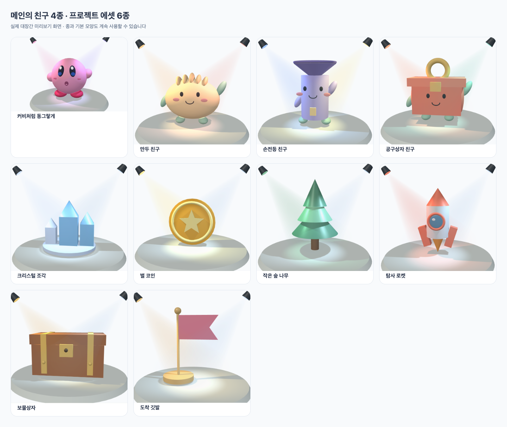

# 메인의 네 캐릭터와 프로젝트 에셋

사용자의 최종 선택에 따라 대장간 캐릭터를 **만두·손전등·공구상자·분홍 친구(커비)** 네 가지로 정리했습니다. 메인 `welcomeParts`와 같은 기본 부품을 사용합니다. 기존의 다른 캐릭터는 새 시작 목록과 기본 보관함에서 숨기며, 이미 저장·공개·포크한 작품은 계속 열고 수정할 수 있습니다.

## 프로젝트에 바로 쓸 모양

| 에셋 | 기본 도형 | 구성 부품 수 | 활용 예 |
|---|---|---:|---|
| 크리스털 | box + pyramid + cylinder | 7 | 보석·에너지 수집 |
| 별 코인 | cylinder + ring + extrusion | 4 | 점수 아이템 |
| 숲 나무 | cone + cylinder | 4 | 크기와 위치를 달리한 숲 |
| 탐사 로켓 | cylinder + cone + box + ellipsoid + ring | 9 | 방향키 우주 탐사 |
| 보물상자 | box + sphere | 10 | 보상 장소·비밀 아이템 |
| 도착 깃발 | cylinder + sphere + extrusion | 4 | 미로 도착점·팀 체크포인트 |

종의 모양 → 클릭 소리 → 음파 효과 세 단계와 기본 모양 다섯 가지도 유지합니다. 최종 시작 목록은 캐릭터 4 + 종과 에셋 7 + 기본 모양 5 = 16개입니다. 공전 시스템은 추가하지 않았습니다.

각 새 모양에 용도, 사용한 도형 이름, 복사 코드 아래에 넣을 한 줄짜리 수정 예를 표시합니다. `object.pos.x += 0.1`, `visible = False`, `rotate(...)` 같은 표준 속성·함수를 사용합니다. 색을 바꾸면 compound의 원래 부품 색에 곱해진다는 설명을 제공합니다. 상자 뚜껑과 손전등은 재사용할 기본 모양이며, 실제 동작·빛 효과는 프로젝트에서 추가합니다. 종만 기존 단계별 소리 체험을 제공합니다.

기본 도형 생성 부분은 짧고 반복되는 부분은 반복문으로 출력합니다. 세 새 캐릭터의 부드러운 입은 25개 점을 반복문으로 이어 만듭니다. 전체 모듈에는 재사용을 위한 위치·배율·제거 함수도 포함됩니다. 모든 완제품은 compound 하나이며, 미리보기 무대는 복사 코드에 포함되지 않습니다. 학생 런타임 AI를 추가하지 않았습니다.

## 크기·표정·기존 자료 보존

- 만두·손전등·공구상자의 기본 부품 위치·방향·색을 메인 모델과 비교합니다. 몸통 슬라이더가 실제 치수를 바꾸는 것도 별도로 검사합니다.
- 만두의 눈·볼은 간격과 몸통 크기를 바꿔도 곡면을 따라 움직입니다. 손전등의 앞뒤 크기는 너비에 함께 따라갑니다. 효과가 불명확한 슬라이더는 숨깁니다.
- 놀람·졸림 표정과 모자·리본·안테나도 제공합니다. 공구상자의 손잡이와 장식이 겹치지 않도록 실제 높이를 계산합니다.
- 변경 전 기존 프리셋 14종의 Python 출력 SHA-256을 고정하여 새 구현이 기존 공개 코드의 읽기·포크 검증을 깨뜨리지 않는지 확인합니다. 구형 자료의 생성기는 삭제하지 않았습니다.
- 한국어·영어 UI, 사용 안내, 두 언어 가이드를 갱신했습니다.

## 사각뿔 호환 오류의 원인과 수정

실제 화면에서 크리스털 끝부분이 상자 내부로 들어가고 밑면 폭도 맞지 않는 문제가 확인됐습니다. 기존 렌더러가 중심에 놓인 4각 원뿔로 사각뿔을 대신 그렸고, 밑면 두 치수 중 큰 값만 반지름으로 사용했으며 `up` 방향을 반영하지 않았습니다. Python의 size·axis 연동과 독립 HTML도 별도 구현이었습니다.

[공식 GlowScript 구현](https://github.com/vpython/glowscript/blob/master/lib/glow/primitives.js)은 pyramid를 box의 하위 타입으로 두고 `__hasPosAtCenter=false`로 처리합니다. [공식 pyramid 문서](https://www.glowscript.org/docs/VPythonDocs/pyramid.html)는 axis를 밑면에서 꼭짓점으로 향하는 벡터, size를 축 길이·밑면 높이·폭으로 설명합니다.

공유 기하 생성기를 도입해 밑면 중심에서 +X 방향으로 뻗는 직사각형 밑면을 정확히 만들고 axis/up 기준으로 회전합니다. 크기 변경 시에도 같은 생성기를 사용하며, 편집기·Python 래퍼·독립 HTML을 함께 수정했습니다. 회전한 사각뿔의 compound 경계는 실제 밑면 네 꼭짓점과 끝점을 투영해 계산합니다. 독립 HTML에서도 해당 도형의 경계는 정밀하게 계산합니다. 깃발은 경로 방향에 따른 단면 가로축 규칙을 적용해 깃대에서 오른쪽으로 펼쳐지도록 했으며 extrusion 런타임은 변경하지 않았습니다.

## Claude 검토

[1차](collaboration/forge-assets-claude-2026-11-07.json), [네 캐릭터 반영 후](collaboration/forge-assets-claude-final-2026-11-07.json), [사각뿔 호환성 검토](collaboration/forge-assets-pyramid-claude-2026-11-07.json)를 받았습니다. 몸통 크기, 곡면 눈 위치, 숨긴 깊이와 표정·장식의 연동, 손잡이 높이, 내보낸 시점, 회전 경계를 보완하고 테스트를 추가했습니다. 단순 부품으로 게임에서 사용할 물건을 만들고 실제 속성 한 줄을 바꾸는 학습 방식은 적절하다는 의견이었습니다. Claude는 정적 검토를 했으며 실제 실행과 화면 검사는 Codex가 수행했습니다.

공유 HTML의 실제 모듈 실행에서 별도로 기존 `vector(v)` 복사 생성자와 `from vpython import *`의 `sqrt`·`sin`·`cos`·`pi` 등 수학 함수 내보내기 누락도 확인했습니다. 편집기와 같은 벡터 복사 및 수학 함수 제공을 적용했습니다. 벡터 복사본 독립성 테스트와 전체 모듈의 실제 공유 HTML 실행으로 확인합니다.

## 최종 검증

- 대장간 수정의 전체 검사: **83개 파일·869개 검사 통과**. lint·프로덕션 빌드와 공유 HTML 서버 테스트 6개도 통과했습니다.
- [실제 로컬 4033 Chromium 검사 15개](collaboration/forge-assets-local-2026-11-07.json): 네 캐릭터 선택, 네 캐릭터와 에셋 6개의 화면·슬라이더·되돌리기·복사, 360px 레이아웃, 영어, 구형 캐릭터 보존, 복사 코드 전체의 실제 Pyodide 실행을 확인했습니다.
- [독립 HTML 실제 실행 검사 5개](collaboration/forge-assets-standalone-2026-11-07.json): 네 캐릭터와 에셋 6개의 전체 코드를 함께 실행하고, 세 크리스털의 밑면 일치, 사각뿔 기준점·방향·크기 변경과 브라우저 오류 없음을 확인했습니다.
- Python 수치 검사는 우리 API 래퍼를 사용하며 공식 VPython 패키지로 실행했다는 뜻은 아닙니다. 실제 브라우저 검사는 합성 비로그인 초안으로 수행했고 계정·DB에 쓰지 않았습니다. 로컬의 별도 진행 중인 런타임·안내·영문 사전 변경도 보존했습니다.

배포 직전 main에 먼저 반영된 빛·소리 실습/런타임 유지 작업 `937eb95`를 강제 push 없이 통합했습니다. **통합된 최종 소스는 86개 파일·896개 검사와 lint·프로덕션 빌드가 모두 통과**했습니다. 로컬 4033의 App·렌더러·런타임 유지 모듈·새 도형·공유 HTML 소스가 통합 소스와 같은 것도 확인했습니다.
