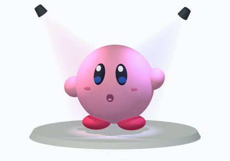
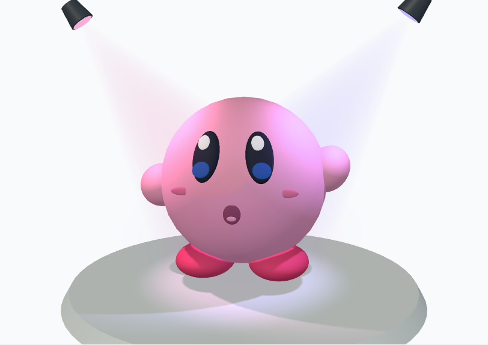

# 대장간 커비를 메인 분홍 친구와 통일

대장간 커비 시작 모양이 메인의 분홍 친구와 달랐습니다. 메인은 둥근 몸통과 큰 타원 눈, 위쪽 흰 하이라이트·아래쪽 파란 부분, 둥근 입을 쓰지만 대장간은 별도 비율과 웃는 입을 생성했습니다. 같은 분홍색도 메인의 CSS 색과 대장간의 숫자 색이 서로 다른 색 공간으로 처리되어 밝기와 광택이 달랐습니다.

## 수정

- 메인 `welcomeParts('kirby')`를 새 대장간 모양의 기준으로 사용합니다. 기본 몸통 1.72 × 1.72 × 1.72, 눈·흰 하이라이트·파란 부분·볼·입·손발의 위치와 크기, 방향과 재질을 맞춥니다.
- 메인의 무대와 분홍/보라 조명, 바닥 그림자, 비슷한 입체 시점을 사용합니다. 무대는 미리보기에만 포함하며 재사용 코드에는 넣지 않습니다.
- 얼굴이 몸통 곡면을 따르며 몸통·눈·팔다리 슬라이더, 세 표정, 되돌리기를 유지합니다. 볼 크기 0은 부품을 생략합니다.
- 15개 부품을 `compound` 한 개로 묶습니다. 내보낸 함수는 위치·배율을 받습니다. `axis` 길이를 `size.x`와 일치시켜 VPython 타원체 의미를 따릅니다.
- 새 모양의 색은 메인과 같은 선형 RGB를 사용합니다. 메인의 커비 체험 코드에도 같은 변환을 적용했습니다. 조명이 다른 외부 실행 환경까지 같은 픽셀을 보장하는 검증은 아닙니다.
- 새 모양에 버전을 붙여 구형 공개 코드의 재생성과 포크 검증을 그대로 유지합니다. 수정·저장·포크 작품은 자동 변경하지 않습니다. 손대지 않은 미보관 구형 시작 초안만 갱신합니다.
- 구형 작업의 **메인 화면 커비로 바꾸기** 버튼은 이름·설명·출처·참고 링크·기록 ID를 유지하고, 되돌릴 수 있습니다. 로그인 전 게스트 초안에도 같은 보존 규칙을 적용했습니다.
- 한국어·영어 사용 가이드를 갱신했습니다.

## Claude 검토와 판단

[1차 검토](collaboration/kirby-review-claude-2026-11-07.json), [수정 후 검토](collaboration/kirby-review-final-2026-11-07.json)를 수행했습니다. 1차 응답은 180초 시간 초과 후 300초 대기로 재시도했습니다. 누락 import, 테스트의 부품 이름 정규화·부동소수 비교, axis 길이, 볼 크기 0을 수정했습니다. 후속 검토가 지적한 메인 체험 코드의 색 변환, 로그인 게스트 초안 갱신, 기본값 외 내보내기 비교도 보완했습니다. `useUiText`는 안정적인 동일 함수를 반환하므로 언어 변경이 미리보기 장면을 재생성한다는 조건부 우려는 해당되지 않습니다.

Claude는 정적 파일을 읽었습니다. 실제 브라우저·Python 실행은 Codex가 수행했습니다. CPython 검사는 우리 VPython API 래퍼를 사용하며 공식 VPython 패키지와의 실행 비교라고 주장하지 않습니다. CI는 Python 3.12를 설치합니다.

## 검증

- 커비·대장간·메인 관련 44개 검사 통과. 새 기본 형상의 각 부품과 메인의 위치·방향·크기·색·거칠기를 비교했습니다.
- 실제 CPython에서 세 표정 × 슬라이더 최소/최대, 볼 없음, 위치 이동·배율 0.7, 메인 체험 코드를 실행했습니다. 생성 위치·크기·방향·색과 compound 부품 수를 비교하고, 기본값은 렌더러의 회전·경계 상자까지 확인했습니다. 구형 코드는 정적 원본과 바이트 단위 비교합니다.
- 전체 회귀검사 **82개 파일·852개 검사 통과**, lint와 프로덕션 빌드 통과. 최초 제한 환경의 포트 수신 거부와 과도한 병렬 실행 타임아웃은 로컬 포트가 허용된 실행 환경에서 동시 작업 4개로 재검사하여 해소했습니다.
- [로컬 4033의 실제 Chromium 검사 10개](collaboration/kirby-local-browser-2026-11-07.json) 통과. 큰 눈 슬라이더·되돌리기, 세 표정, 360px 레이아웃, 구형 초안 보존과 갱신, 복사한 소스와 실제 Worker 전달 소스 동일성, Pyodide 실행과 compound 15부품을 확인했습니다. 비로그인 합성 초안으로 검사했으며 실제 계정·DB에 쓰지 않았습니다.

## 실제 화면

메인 기준:

대장간:

## 운영 배포 결과

기능 소스 `58ba2bf7ad54cd09f860bdbe43204d9381023416`를 main에 반영했습니다. Vercel·Railway 배포 성공과 실제 서버 health의 `commitSha=58ba2bf7ad54`를 확인했습니다. [GitHub CI](https://github.com/greatsong/vpylab/actions/runs/42355054815) 7개 작업 모두 성공했습니다.

[운영 Chromium 검사](collaboration/kirby-production-browser-2026-11-07.json)도 10개 모두 통과했습니다. 로컬과 같은 모양·슬라이더·되돌리기·세 표정·모바일·구형 초안 보존과 갱신·복사 코드의 실제 Pyodide 실행을 확인했습니다. [배포와 CI 증거](collaboration/kirby-production-proof-2026-11-07.json)를 남깁니다.

