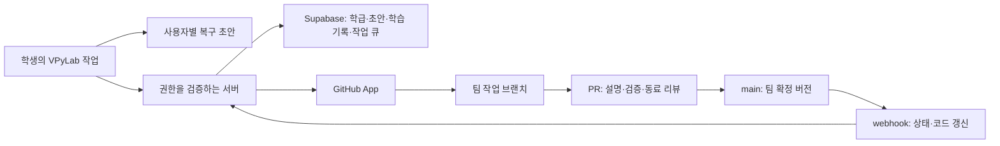

# VPyLab 2027학년도 수업 준비도 검토

- 검토일: 2026-10-28 (한국 시간)
- 코드 기준: `605d7c8` (`2026-07-07`, 현재 로컬 HEAD)
- 목적: 운영 안정성, 학생 작업 보존, 팀 프로젝트와 GitHub 협업, 사고력·창조적 문제해결 교육의 연결
- 범위: 현재 소스·SQL 마이그레이션·CI·기존 문서 검토, 로컬 테스트/린트/빌드, 실제 모듈을 사용한 격리 재현
- 제한: 운영 Supabase 정책·백업 설정, 로그인한 다중 브라우저, 실제 GitHub OAuth/PR, 학급 부하 시험은 이번에 검증하지 않았습니다. 운영 배포와 로컬 HEAD의 일치도 확인되지 않았습니다. 아래의 SQL 결함은 저장소 정의 기준입니다.

## 1. 판단

**현재 코드를 그대로 정규 수업의 유일한 작업 저장소로 사용하는 것은 권하지 않습니다.** 실행·콘텐츠·프로젝트·이력 기능의 기반은 있지만, 다른 프로젝트로 잘못 저장되는 경합, 팀원의 변경 덮어쓰기, 공용 PC의 계정 간 기록 혼합, 익명 공개 설정 위반이 남아 있습니다. 권한 정책도 우선 보강해야 합니다.

확장 방향은 구체적입니다. VPyLab에서 문제를 정의하고 Python으로 실험하며, GitHub에 팀의 변경·검증·리뷰를 남기는 수업 도구로 발전시킬 수 있습니다. 우선순위는 **권한과 작업 보존 → 동시 작업과 복구 → GitHub 리뷰 흐름 → 학습 과정 평가**입니다.

현재의 강점도 유지해야 합니다. VPyLab 저장과 GitHub 반영 실패를 구분하고, 코드 스냅샷·작성자 이력·팀원 저장 알림·재시도 대기열을 갖추고 있습니다. GitHub 커밋에는 여러 파일을 한 번에 반영하는 로직과 시간 제한도 있습니다. 다만 이것만으로 학생 편집 충돌이나 데이터 보존이 보장되지는 않습니다.

## 2. 수업 전 우선 해결할 문제

P1은 수업 투입 전에 수정·재검증할 문제, P2는 이어서 보강할 문제입니다. ‘격리 재현’은 실제 소스 함수를 실행하되 외부 DB/GitHub/브라우저 환경을 mock한 결과입니다. 실제 서비스 공격이나 운영 데이터 변경은 하지 않았습니다.

### 2.1 P1 — 프로젝트 전환 중 자동저장이 다른 코드를 덮어씁니다

자유 코딩의 2초 자동저장이 예약된 상태에서 본인이 소유한 팀 프로젝트를 열면, 타이머는 이전 본문을 가지고 실행하면서 저장 대상은 새 `currentCodeId`에서 읽습니다. 격리 재현에서 `private code A`가 `team-code-B`에 UPDATE되고 저장 성공 상태가 됐습니다. 팀 프로젝트 화면의 자동저장 생략은 이미 예약된 작업을 취소하지 않습니다.

- 근거: `client/src/stores/codeStore.js:247–283`, `client/src/pages/Sandbox.jsx:268–274, 598–619`.
- 수정: 예약 시 사용자·코드·프로젝트·편집 세대를 고정하고, 전환 때 취소하며, 비동기 경계 이후에도 세대 일치를 검사합니다. 타이머 취소만으로 이미 전송한 요청까지 취소되는 것은 아닙니다.
- 합격 기준: 저장 응답을 지연시킨 채 프로젝트를 전환해도 이전 본문이 새 프로젝트에 쓰이지 않습니다.

### 2.2 P1 — 두 학생의 저장이 서로의 변경을 덮어씁니다

팀 코드는 `id`만 조건으로 본문 전체를 UPDATE합니다. 두 학생이 같은 버전을 열고 A가 먼저 저장한 뒤 B가 오래된 본문을 저장하면 A의 변경이 현재 본문에서 사라집니다. Realtime 알림은 저장을 차단하지 않습니다.

GitHub 쪽도 같은 문제가 있습니다. 최초의 최신 revision 검사 이후 요청이 지연되면, 다른 학생의 새 커밋과 충돌할 수 있습니다. 현재 재시도는 새 HEAD를 읽어 오래된 본문을 다시 커밋합니다. 격리 재현에서 A(H0) → B(HB) → A의 충돌 재시도(parent=HB) 순서로 최종 코드가 오래된 A로 돌아갔습니다. `force:false`는 이런 편집 의미의 충돌을 해결하지 않습니다.

- 근거: `client/src/stores/codeStore.js:157–168`, `client/src/stores/projectStore.js:1865–1879, 1442–1471`, `server/routes/projects.js:249–324, 1700–1727`.
- 수정: DB 저장은 기준 버전 비교와 코드·revision 생성이 한 트랜잭션에서 수행되어야 합니다. GitHub 변경은 편집 시작의 base commit을 검증하고, 변경됐으면 양쪽 초안과 diff를 보존해 병합하도록 합니다. 오래된 전체 본문을 자동 재시도하지 않습니다.
- 합격 기준: A/B의 같은 기준 버전 저장 중 하나는 충돌로 처리되며 두 초안이 모두 복구 가능합니다.

### 2.3 P1 — 팀 초안과 미션 코드의 보존이 불충분합니다

팀 모드는 자동저장을 생략하며 일반적인 로컬 초안 복구 경로가 없습니다. 미저장 상태에서 새로고침하거나 프로젝트를 열면 작업을 잃을 수 있습니다. 미션 화면에서는 저장 코드 조회가 끝나기 전에 시작 코드의 자동저장이 예약되고, 늦은 조회 응답이 학생의 새 편집을 교체할 수도 있습니다.

- 근거: `client/src/pages/Sandbox.jsx:264–274, 598–619`, `client/src/pages/MissionPlay.jsx:51–65`.
- 수정: 사용자·프로젝트·미션별 로컬 초안을 서버 저장과 독립적으로 보존합니다. 서버 코드 로드 완료 전 자동저장을 막고, 로드 도중 편집했으면 응답이 본문을 덮지 않게 합니다. 프로젝트 열기·교사 코드 교체·이력 복원에 공통 보존 절차를 적용합니다.
- 합격 기준: 오프라인 편집 후 새로고침, 느린 로드 중 입력, 다른 프로젝트 이동에서 작성 내용이 복구됩니다.

### 2.4 P1 — 공용 PC의 계정 분리가 완전하지 않습니다

진행률은 사용자 구분 없이 `vpylab-progress` 하나에 저장되고 로그인 시 현재 사용자 명의 제출로 동기화됩니다. 격리 재현에서 A의 미션 100점이 B의 `user_id`로 INSERT됐습니다.

로그아웃 정리는 projectStore/codeStore에 한정됩니다. 실제 편집 본문을 가진 Sandbox의 React 상태는 남으므로, 같은 탭에서 다른 계정으로 전환하면 이전 학생의 코드가 화면에 남거나 새 계정 저장 대상으로 넘어갈 수 있습니다. 이 에디터 경로는 정적 분석이며 실제 계정 브라우저 재현이 추가로 필요합니다.

- 근거: `client/src/stores/appStore.js:41–89`, `client/src/stores/authStore.js:199–216`, `client/src/pages/Sandbox.jsx:62, 117, 268–274`, `client/src/App.jsx:57`.
- 수정: 사용자별 저장 키와 계정 전환 세대를 도입하고, 진행률·편집기·공유·이력 상태와 진행 중 요청을 함께 정리합니다. 비로그인 기록 가져오기는 명시적으로 선택하게 합니다.
- 합격 기준: A 로그아웃 → B 로그인 뒤 A의 코드·기록·알림이 보이거나 B에게 저장되지 않습니다.

### 2.5 P1 — 익명 발행이 실제 이름을 가리지 못합니다

발행 모달은 ‘공개 이름/익명’을 제공하지만, 조회·표시는 작품의 별칭보다 실제 프로필 이름을 우선합니다. 공개 작품 작성자의 프로필을 누구나 읽게 하는 RLS도 있습니다. 프로필에 실명이 들어 있으면 익명 선택의 의미가 사라집니다.

- 근거: `client/src/components/gallery/PublishModal.jsx:247–258`, `client/src/stores/galleryStore.js:10–24`, `client/src/pages/GalleryDetail.jsx:79–81`, `client/src/components/gallery/GalleryCard.jsx:36`, `supabase/migrations/006_gallery_collaboration.sql:9–15`.
- 수정: 공개 작품은 선택한 공개 이름만 표시하고, 공개 응답에서 학급용 프로필을 분리합니다. 화면만 가리는 방식으로는 API의 프로필 공개를 막을 수 없습니다.
- 합격 기준: 익명 작품의 공개 화면·API 응답에 실제 이름·학급 프로필이 포함되지 않습니다. GitHub 계정·커밋 정보가 공개될 수 있다는 범위도 별도로 안내해야 합니다.

### 2.6 P1 — DB 권한 정책에 우회 경로가 있습니다

저장소 마이그레이션에서 다음 조건이 빠져 있습니다. 실제 운영 DB가 같은지 읽기 전용으로 대조해야 합니다.

| 문제 | 코드 근거 | 필요한 보강 |
|---|---|---|
| 자신을 임의 프로젝트의 editor/owner로 직접 INSERT 가능 | `012_fix_rls_recursion.sql:70–74` | 자기 자신이라는 이유만으로 INSERT 허용하지 않기. 초대 검증 RPC 또는 소유자 승인으로만 가입 |
| 프로필 INSERT/UPDATE가 자신의 id만 검사하고 role 변경을 제한하지 않음 | `001_vpylab_schema.sql:88–92`, `007_admin_features.sql:9–48` | role·권한 관련 필드는 일반 프로필 수정과 분리하고 DB에서 보호 |
| revision의 project_id와 code_id 소속 일치를 검사하지 않음 | `017_fix_revision_insert_hole.sql:18–23` | 코드 행과 실제 프로젝트를 함께 검증. 작성 시각·부모 revision도 서버에서 확정 |

프로필 SELECT 정책의 자기참조도 남아 있어 새 설치에서 재귀 오류를 유발할 수 있습니다(`001_vpylab_schema.sql:77–85`). 역할 상승 경로가 그 오류에 막힐 가능성이 있으므로, ‘현재 운영에서 관리자 권한 탈취를 실증했다’는 뜻은 아닙니다. 역할 보호와 재귀를 함께 수정해야 합니다.

학급 가입 역시 신규 학생이 초대 코드로 학급을 조회하지만, 학급 SELECT는 기존 구성원·교사에게만 허용하는 정의라 정상 가입이 막힐 수 있습니다(`authStore.js:238–246`, `001_vpylab_schema.sql:117–124`). 학급도 초대 검증 RPC가 필요합니다.

### 2.7 P1 — 서버의 프로젝트·저장소·편집 권한 검증이 분리돼 있습니다

`requireTeamProjectAccess`는 projectId가 주어지면 그 프로젝트에 멤버인지 확인할 뿐, 편집 역할과 GitHub 저장소의 일치를 확인하지 않습니다. 이후 커밋 성공 처리에서 service-role로 요청의 projectId에 연결된 갤러리를 UPDATE합니다. 격리 재현에서 viewer가 자기 GitHub repo에 커밋하면서 다른 프로젝트의 갤러리 본문을 바꾸는 경로가 통과했습니다.

- 근거: `server/middleware/require-supabase-user.js:95–119`, `server/routes/projects.js:1878–1884`.
- 수정: 서버가 프로젝트에서 repo·코드·편집 역할을 확정합니다. 요청자가 준 식별자를 각각 신뢰하지 않고 하나의 권한 경계로 검증해야 합니다.
- 합격 기준: viewer, 탈퇴자, repo/project/code/revision 조합 불일치 요청은 GitHub·갤러리 쓰기 전에 거절됩니다.

### 2.8 P1 — 무한루프가 화면 밖에서 계속 실행될 수 있습니다

실행 화면을 떠나면 훅은 구독과 감시 타이머를 제거하지만 Worker는 중지하지 않습니다. 다른 실행 화면에서 초기화할 때 running Worker를 종료하지 않고 새 Worker로 전역 참조를 바꿉니다. 격리 재현에서 이전 Worker 미종료, 감시 타이머 0개, 새 Worker 생성이 확인됐습니다.

- 근거: `client/src/hooks/usePyodide.js:148–167`, `client/src/engine/pyodide-singleton.js:62–76`.
- 수정: Worker 실행 소유권과 생명주기를 명시하고, 화면 이탈 시 실행을 종료하거나 중앙 감시를 계속 유지합니다. 새 Worker 생성 전에 기존 Worker를 반드시 회수합니다.
- 합격 기준: `while True: pass` 실행 → 페이지 이동 → 재진입 후 이전 Worker가 남지 않고 새 코드가 실행됩니다.

### 2.9 P1 — 학교의 공유 IP에 API 제한이 집중됩니다

프로젝트 생성·접근 확인·커밋·초대·학급 조회가 동일한 IP 기준 분당 10회 limiter를 공유합니다. 인증 전 차감됩니다. 실제 limiter의 격리 실행에서 동일 IP 요청 10개는 통과하고 11번째는 429였습니다. 학생 30명이 동시에 접근하면 정상 사용도 제한될 수 있습니다.

- 근거: `server/routes/projects.js:24–30, 1254, 1381, 1658, 1938`.
- 수정: 인증 사용자·작업 종류별 한도와 IP 기반 남용 방어를 분리합니다. 재시도에는 서버가 지정한 대기 시간을 적용하고, 여러 서버 인스턴스에서는 공유 저장소 기반 한도를 검토합니다.
- 합격 기준: 실제 학교 네트워크에서 한 학급 동시 저장·프로젝트 접근이 정상 사용 한도에 걸리지 않습니다.

## 3. 뒤이어 보강할 항목

| 우선순위 | 확인 내용 | 근거/방향 |
|---|---|---|
| P2 | 정지 직후 재실행이 3초 강제 종료 예약을 취소해 멈춘 Worker 복구 지연 | `usePyodide.js:121–134, 175–179`. 격리 재현에서 3초가 아닌 13초에 종료. 종료 확인 전 실행 가능 상태로 표시하지 않기 |
| P2 | 반복문 print가 종료 전 전송되지 않고 StringIO에 누적 | `pyodide-worker.js:322–343`, `vpython-api.py:1900–1917`. 실제 Python API 100회에서 stdout 메시지 0, batch 100. 출력 스트리밍·버퍼 상한 필요 |
| P2 | GitHub SHA 갱신을 클라이언트에서 시도하지만 revision UPDATE RLS 없음 | `009_code_revisions.sql:69`, `projectStore.js:1563–1569, 1665–1671`. 서버의 검증된 갱신 경로와 갱신 행 수 확인 필요 |
| P2 | GitHub 미연결 일지는 합쳐진 메시지 200자만 남아 막힌 점·다음 할 일이 잘림 | `codeStore.js:116`, `projectStore.js:2009–2050`. 회고 원문은 구조화된 별도 레코드로 저장 |
| P2 | 교사 기여도는 코드 변경·일지·반복 저장을 모두 revision 수로 계산 | `projects.js:2018–2023`, `ClassTeamOverview.jsx:153`. 활동량 보조지표로 표시하고 평가 점수와 분리 |
| P2 | 공개 작품의 코드가 최신 저장으로 계속 바뀌어 발표·평가 버전 고정이 어려움 | `projects.js:1878–1884`, `PublishModal.jsx:122`. source revision/commit을 고정한 제출·발표본 제공 |
| P2 | GitHub provider token fallback이 지정한 storageKey와 다름 | `lib/supabase.js:10`, `authStore.js:168–174`. `vpylab-auth`를 사용하지만 fallback은 `sb-*-auth-token` 검색. 새로고침·토큰 만료 통합 검증 필요 |

## 4. 운영과 배포 검증

### 이번 실행 결과

| 검증 | 결과와 해석 |
|---|---|
| 원본 client `npm ci` | npm 11.6.2 및 임시 사본의 npm 10.8.2에서 @emnapi 항목 누락/불일치로 실패. Node는 25.2.1 사용. CI의 Node 20과 완전히 같은 환경은 아님 |
| 기존 버전 유지 검증 | 임시 폴더의 lockfile만 보정해 Vite 8.0.8 / Vitest 4.1.4 / Monaco 0.55.1 유지 후 실행. 원본 manifest/lockfile은 변경하지 않음 |
| 기존 전체 테스트 | 7파일, 164개 통과 |
| 기존 버전 린트 | 오류 0, 경고 6 |
| 기존 버전 빌드 | 성공. Monaco JS 약 4.21MB, gzip 약 1.08MB로 학교망·저사양 기기 로딩 검증 필요 |
| 버전 범위 재해석 설치 | `npm install --package-lock=false`로 최신 범위를 설치하면 린트 오류 3개·경고 6개, Monaco worker import 빌드 실패. 기존 잠금 버전의 소스 빌드 실패와 구분해야 함 |
| 서버 `npm test` | 종료코드 0이지만 실제 테스트 파일 없음. 서버 검증 통과의 근거로 쓸 수 없음 |
| 학생 실행·저장 격리 재현 | 자동저장 대상 변경, Worker 이탈/재실행, 계정 간 진행률 복사 등 assertion 통과 |
| GitHub·서버 격리 재현 | IP 한도, repo/역할 검사 누락, 갤러리 변경, GitHub 충돌 재시도 덮어쓰기 4건 재현 |
| 공개 프론트 HEAD 요청 | `/sandbox` HTTP 200 및 CSP/HSTS 확인. 로그인·Python 실행 성공을 의미하지 않음 |
| 문서의 운영 서버 health | 실행 환경의 curl 연결 실패, web 도구 접근도 실패. 서버 장애로 단정할 수 없으며 실제 운영망에서 재확인 필요 |

### 운영 준비에서 필요한 증거

- CI는 현재 미션 테스트만 실행합니다. 전체 테스트와 서버 인증·권한·팀 충돌·RLS 통합 검증을 배포 필수 조건으로 넣어야 합니다(`.github/workflows/ci.yml:29–31`, `server/package.json`).
- 루트 Vercel 설정은 `npm install`로 빌드합니다. 깨끗한 `npm ci`가 동작하도록 잠금 파일과 Node/npm 버전을 먼저 정리해야 합니다(`vercel.json`).
- health는 DB·스키마·GitHub 기능 상태를 검사하지 않고 항상 ok를 반환합니다. 외부 의존 상태를 구분하는 readiness와 저장 실패·동기화 지연 지표가 필요합니다(`server/index.js:41–49`). GitHub 장애는 코드 실행·초안 보존을 막지 않아야 합니다.
- GitHub 재시도 대기열은 브라우저 localStorage에 있습니다. 브라우저 종료·기기 변경과 무관하게 처리할 서버 outbox가 필요합니다(`projectStore.js:227–245`).
- README는 Render 중심인 반면 현재 가이드는 Railway이며, 기본 마이그레이션 적용 목록은 009–012/014만 포함하고 015–017은 빠져 있습니다. 대상 Supabase project ref도 고정입니다. 새 설치와 보안 수정 적용 경로를 분리하고 실제 스키마 버전을 확인해야 합니다(`README.md`, `scripts/apply-migrations.mjs:22–33`).
- 데이터 리셋용 013은 일반 마이그레이션 폴더에 있습니다. 표준 전체 적용 도구가 실수로 실행하지 않도록 관리 작업으로 분리해야 합니다. 이번에는 마이그레이션을 적용하지 않았습니다.
- 백업 존재뿐 아니라 별도 환경으로 복원 후 코드·revision·팀 권한을 확인하는 훈련이 필요합니다. 운영 Pro 백업 설정과 실제 복원 시간은 미확인입니다.

## 5. GitHub를 팀 프로젝트의 기반으로 만드는 구조

### 현재 구현의 의미

현재는 **Supabase 코드 저장 → GitHub 비동기 반영** 구조입니다. 프로젝트를 다시 열 때도 Supabase를 읽습니다(`projectStore.js:1066–1115, 1865–1910`). `?repo=`로 공개 main.py를 가져오는 별도 경로가 있지만 지속적인 양방향 동기화는 아닙니다. GitHub 직접 수정, PR 병합을 다시 가져오는 webhook/충돌 해결 흐름은 없습니다.

따라서 지금 ‘GitHub가 팀 코드의 기준 저장소’라고 안내하면 실제 동작과 다릅니다. 우선 기존 구조의 데이터 손실을 해결하고, 이후 GitHub의 브랜치·commit SHA를 기준으로 협업 흐름을 전환하는 순서가 적절합니다.

### 권장 역할

| 구성 | 맡길 책임 |
|---|---|
| VPyLab | 문제 정의, 편집·3D 실험, 실행 결과 비교, diff·리뷰, 자기 설명 |
| GitHub | 팀의 확정 코드와 변경 이력, Issue, 브랜치, PR, 리뷰·병합, 발표 버전 |
| Supabase | 로그인·학급·권한, 개인/팀 초안, 학습 과정 기록, 제출·교사 피드백, 동기화 상태 |
| 서버 + GitHub App | 권한 검증, 서버 작업 큐, webhook 검증·중복 처리, GitHub 작업·장애 복구 |



학교/교사 조직의 선택한 저장소에 설치하는 GitHub App을 권장합니다. 저장소별 접근과 세부 권한, 짧은 토큰을 사용할 수 있어 현재 `public_repo` OAuth보다 접근 범위를 통제하기 쉽습니다. installation token을 사용하면 GitHub상 행위 주체가 앱 봇이 될 수 있으므로 학생 기여는 인증된 VPyLab 사용자·학습 기록·검증된 GitHub 계정의 연결로 보존해야 합니다. 표시명이나 커밋 메시지만으로 신원을 판단하면 안 됩니다. [GitHub 공식 비교 문서](https://docs.github.com/en/apps/oauth-apps/building-oauth-apps/differences-between-github-apps-and-oauth-apps)

초안은 수시로 저장하고, 의미 있는 변경을 팀 브랜치에 제출하며, 동료 검토 후 main에 병합합니다. 편집 시점의 base revision/base commit을 유지해야 합니다. GitHub가 끊겨도 초안은 남고, 재연결 후 외부 변경과 비교해서 반영합니다. DB 저장과 GitHub 반영을 하나의 성공으로 표시하지 않고 ‘초안 보존 / GitHub 대기 / 충돌 / 반영 완료 / 공개본 배포’를 구분합니다.

현재 저장소 생성은 공개로 고정되어 있습니다(`projects.js:1054`). 학급 작업은 비공개를 기본으로 설계하고 발표 공개는 별도 선택으로 두는 편이 학생에게 적합합니다. 비공개 저장소의 Pages 지원은 플랜에 따라 달라지며, 기본 Pages에는 시간당 10회 빌드 soft limit도 있으므로 저장할 때마다 공개 페이지 즉시 갱신을 보장해서는 안 됩니다. 수업 실험 미리보기는 VPyLab에서 제공합니다. [Pages 공식 한도](https://docs.github.com/en/pages/getting-started-with-github-pages/github-pages-limits)

전 세계 학교로 확장할 때 GitHub 계정을 모든 학생에게 필수로 요구하는 설계는 피해야 합니다. GitHub는 최소 13세 조건과 국가별 더 높은 최소 연령 가능성을 명시합니다. 수업 참여 방식은 대상 연령·학교 운영 정책에 맞게 정해야 합니다. [GitHub 계정 약관](https://docs.github.com/en/site-policy/github-terms/github-terms-of-service#3-account-requirements)

## 6. AI 시대의 사고력과 창조적 문제해결을 위한 수업 흐름

제품의 중심 경험은 **문제 정의 → 가설 → 제작·실험 → 반례 확인 → 동료 리뷰 → 설명·성찰**로 잡는 것을 제안합니다. GitHub는 이 과정의 증거를 보관하고 VPyLab은 학생이 수행하기 쉬운 화면을 제공합니다.

| 단계 | 학생 행동 | 남길 증거 |
|---|---|---|
| 문제 정의 | 사용자·제약·성공 조건·측정 방법을 정함 | Issue: 문제 설명, 조건, 성공 기준 |
| 가설과 설계 | 결과를 예상하고 대안을 비교 | 예상 결과, 선택 이유, 역할 분담 |
| AI와 제작 | 먼저 자신의 접근을 적고 AI 제안을 판단 | 질문, 채택/거절 이유, 출처, 핵심 코드 자기 설명 |
| 실험과 디버깅 | 예상/실제를 비교하고 실패 사례를 재현 | 입력 조건, 관찰 결과, 반례, 수정 전후 실행 |
| 팀 리뷰 | 다른 학생의 diff를 읽고 검증 | PR 설명, 실행 미리보기, 리뷰 질문과 답변 |
| 발표와 성찰 | 확정 버전을 시연하고 다음 개선을 제안 | 고정 commit, 한 일·막힌 점·다음 할 일, 개별 설명 |

3인 팀은 설계자·구현자·검증자를 차시마다 교대할 수 있습니다. AI 도움의 양이나 커밋 수가 아니라 문제를 명확히 했는지, 대안을 비교했는지, 실험으로 판단했는지, 동료의 변경을 검토하고 설명할 수 있는지를 평가합니다. 저장 횟수·코드 줄 수는 활동 참고자료로만 사용합니다.

예를 들어 ‘충돌을 피하는 이동체’ 과제에서 학생은 속도·안전거리의 관계를 먼저 예상하고, AI가 만든 회피 코드를 여러 조건으로 실행합니다. 성공 장면 하나 대신 실패하는 배치·속도를 찾아 원인을 설명하고 개선 PR을 제출하게 할 수 있습니다. VPyLab의 3D 실험과 GitHub의 검토 이력이 자연스럽게 연결됩니다.

현재 코드에는 Upstage AI 힌트 라우트가 없고 관련 계획·README·개인정보 안내가 실제 구현과 어긋납니다. AI 기능을 추가할 때는 힌트의 단계·예측 질문·반례 제안·자기 설명을 설계하고, 실제 전송 데이터와 기록 보존을 문서에 맞춰야 합니다. AI 호출 기능의 존재만으로 사고력 교육이 성립하지는 않습니다.

## 7. 2027학년도 전 권장 진행 순서와 합격 조건

| 순서 | 완료할 일 | 다음 단계로 넘어갈 조건 |
|---|---|---|
| 1. 작업·권한 보호 | 2장의 P1, 사용자별 초안, 동시 저장 비교, 안전한 Worker 종료 | 데이터가 잘못된 대상에 저장되지 않고 정의한 오프라인·새로고침·전환·저장 실패 시나리오에서 초안 복구 가능. 비멤버/viewer 권한 시험 통과 |
| 2. GitHub 신뢰성 | 서버 outbox, App 연결, base SHA 검사, webhook, 명확한 반영 상태 | 장애·토큰 만료·브라우저 종료 후 재시도에도 중복/역순 덮어쓰기 없음 |
| 3. 팀 학습 흐름 | Issue·PR·리뷰·고정 제출본, 구조화한 회고, 교사 증거 보기 | 학생이 Git 명령을 몰라도 문제→실험→리뷰→설명을 완료 가능 |
| 4. 실제 학급 파일럿 | 학교망·저사양/Chromebook·실계정 검증, 복원 훈련 | 아래 시나리오를 통과하고 교사가 장애 시 수업을 이어갈 수 있음 |

필수 시나리오는 ① 같은 버전 A/B 동시 저장 ② 오프라인·새로고침·기기 변경 ③ 저장 중 프로젝트 이동 ④ 공용 PC A→B 계정 전환 ⑤ 무한루프 정지·재실행·페이지 이동 ⑥ 익명 작품 비로그인 조회 ⑦ 토큰 만료·GitHub 403/429·장애 ⑧ GitHub 직접 수정/PR 병합 후 재개 ⑨ 신규 설치/마이그레이션 ⑩ 백업 복원입니다.

한 학급 약 30명에서 시작해 두 학급 동시 접속으로 확대하고, 저장 실패율·충돌·동기화 지연·초안 복구 성공·엔진 준비 시간을 측정하는 것을 제안합니다. ‘손실 없는 초안 복구’, ‘공유 IP에서 정상 학생 요청 차단 없음’, ‘교사가 확정 제출본을 다시 실행 가능’을 출시 조건으로 두는 것이 적절합니다. 처리 시간의 구체적인 목표는 실제 학교망 측정 뒤 확정해야 합니다.

이번 검토에서는 제품 코드·운영 DB·GitHub 저장소를 변경하지 않았습니다. 원본 manifest/lockfile도 유지했습니다. 수정 작업의 첫 단위는 **권한 우회 차단 + 프로젝트/계정 전환 중 초안 보호 + 의미 있는 회귀 검증**으로 묶는 것을 권장합니다.

## 부록: 재현 자료

검토 세션의 임시 재현 스크립트:

```sh
node /private/tmp/vpylab-student-audit-repro.mjs
node /private/tmp/vpylab-github-audit-repro.mjs
```

두 파일은 임시 경로이므로 운영 회귀 테스트로 정식화해야 합니다. mock 검증을 실제 DB/RLS·브라우저·GitHub 통합 검증과 동일하게 해석하면 안 됩니다. 7월의 기존 감사·수동 검증 문서에 적힌 통과 결과도 이번 시점의 운영 검증 결과를 대체하지 않습니다.
