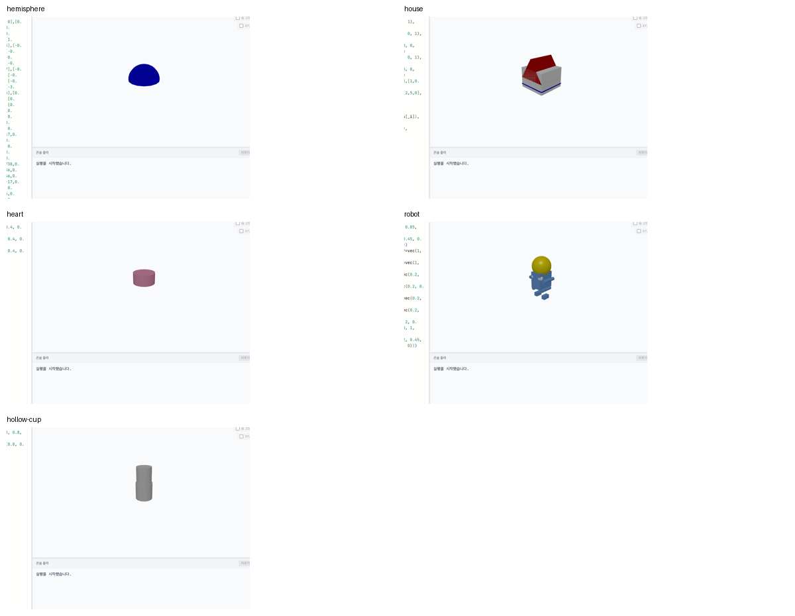

# 도형 AI·compound·카메라·학습 이동 검토

2026-11-06~07, 코딩이 처음인 중·고등학생 기준. 로컬 수정·검증이며 운영 배포는 하지 않았다.

## 결론과 판단할 사항

- **전체 문서를 제공해도 Solar Pro 4의 도형 정확성은 보장되지 않는다.** 실제 6개 요청에서 JSON·수치 검사는 모두 통과했고, 정적 도형 5개는 실제 Pyodide/Three.js에서 오류 없이 표시됐다. 그러나 속이 빈 컵을 닫힌 원기둥 두 개로 만들고 비어 있다고 설명했다. 하트는 원기둥처럼 보였다. 실행 성공과 원하는 모양의 정확성은 다른 검사다.
- 기본 교육은 **직접 만들기 → 숫자·벡터 바꾸기 → 친구가 보고 해석하기 → 설명하기**를 유지한다. 반구 제공 함수와 기본 도형 변형 가이드가 우선이다. AI를 기본 메뉴에 추가하지 않았다.
- AI를 도입한다면 **도형만 선택적으로 제안하고 미리 본 뒤 학생이 채택하는 실험 기능**으로 한정한다. 전체 과제·게임·빛/소리 프로그램을 대신 작성하지 않는다. 현재 원형은 공개 라우트나 학생 화면에 연결하지 않았다.
- 사용자가 판단할 부분은 이 선택 기능의 도입 여부다. **권고: 기본은 끄고, 허용 도형별 의미 검사를 보강한 뒤 교사 실험부터 진행.** 이번 결과로 자동 도입을 권할 근거는 부족하다.

## 3-way 실제 검토와 채택

사용자의 “최소 코드 사본 전송 승인” 이후 “풀 코드” 지시를 반영했다. Claude와 Gemini Argon 모두 프론트·서버·엔진·테스트·설계 문서가 있는 전체 코드 사본을 열람할 수 있었다. 키·인증 파일·학생 작품 원문·학생 카탈로그·Git 이력·의존성·빌드·기존 로그는 제외했다. 자체 교육 콘텐츠는 별도 경로 안내와 함께 제공했다. 전체 사본 제공과 모든 파일을 실제로 읽었다는 주장은 구분한다.

| 검토 | 주요 제안 | 처리 |
| --- | --- | --- |
| Claude 1차, 정적 | center 변경 시 시선 축 보존, 거리 제한·resize, Python 최신 값과 10Hz 스냅샷 경합, compound 기본 재질·중첩 | 반영하고 실제 실행/브라우저 검사 추가 |
| Gemini Argon, 정적 | 안내→실습→복귀 때 원본이 수정본을 덮음, 모바일 복귀 숨김, 새 탭 증식, 명칭·접근성 | 탭 내 초안 복원·상시 복귀 링크·같은 탭·트레이닝 명칭·Escape/패널 상태 반영 |
| Claude 후속, 정적 | 자동 맞춤 중 forward 지정이 줌을 멈춤, 큰 물체 follow 초기 거리, 깊이 잘림·휠 조작 후 near | 코드 추적을 확인해 수정, 해당 재현을 회귀 검사로 고정 |
| Claude의 시야각 추정 | short-axis fov 가능성 | 공식 WebGLRenderer 원문을 확인해 채택하지 않음. 세로 fov와 portrait의 range/aspect 보정 사용 |
| Claude의 standalone revision 후보 | 메인 Python과 같은 비동기 스냅샷일 경우 revision 누락 | standalone은 별도 inline Python이며 명령 flush 후 JS에 동기 질의한다. 조건부 추정은 해당하지 않으며 실제 독립 HTML에서 값 읽기 검증 |

후속 Claude는 이번 제한된 읽기에서 compound·이동 UI를 다시 검토하지 않았다고 명시했다. 모델 검토는 정적이며 실행 검증은 호스트가 수행했다. “모든 모델이 최종 코드를 실행해 승인했다”는 의미가 아니다. 초기 광범위 호출의 timeout/빈 응답은 성공한 검토로 세지 않았다. 성공한 원문은 `docs/collaboration/*review*2026-11-07.json`, `camera-claude-*.json`에 보관했다.

## compound: 원인과 변경

1. **색 의미와 문서 불일치:** VPython compound는 부품의 원래 색에 compound 색을 곱한다. 기본 흰색은 원래 색을 보존한다. 예를 들어 cyan × yellow = green이다. 전체를 동일한 색으로 바꾸려면 부품을 흰색으로 만들거나, 부품을 따로 바꾸는 `group()`을 사용한다. 기존 “전체 덮어쓰기/color=None” 문서를 고쳤다.
2. **실제 투명도 결함:** 불투명 재질이 이미 컴파일된 뒤 `transparent`만 바꾸고 `needsUpdate`를 올리지 않았다. Three.js의 OPAQUE 셰이더 경로가 남을 수 있었다. 투명/불투명 전환 시 셰이더 버전을 갱신하고 depthWrite도 맞췄다.
3. 원래 부품 색·불투명도를 따로 보관해 반복 변경이 누적되지 않게 했다. `color.white`, `opacity=1`로 복원한다. 부품의 기존 반투명도와 정점 alpha도 유지한다.
4. 기본 생성이 부품의 emissive/shininess를 덮지 않게 하고, 명시한 compound 속성과 이후 대입은 적용한다. 중첩 compound의 안쪽 재질 업데이트가 바깥쪽 필터를 덮지 않도록 처리한다. 중첩된 compound의 개별 수정은 group을 쓰도록 안내한다.
5. 편집기와 공유 HTML은 `server/shared/compound-appearance.js`의 같은 재질 적용기를 쓴다. shader 기반 정점 재질, 반복 투명도 변경, 흰색 복원 및 공유 HTML도 검사했다.

```python
from vpython import *
a = sphere(pos=vec(-1,0,0), color=color.white)
b = box(pos=vec(1,0,0), color=color.white)
c = compound([a,b])
c.color = color.orange
c.opacity = 0.4
c.shininess = 0.9
c.emissive = True
# 원래 부품 색과 불투명도로 복원
c.color = color.white
c.opacity = 1
```

## 카메라: 원인과 변경

| 문제 | 원인 | 변경·검증 |
| --- | --- | --- |
| center를 바꾸면 시선이 틀어짐 | target만 이동하고 카메라는 고정 | 카메라도 같은 벡터만큼 평행 이동. axis/forward/거리 보존 |
| pos/axis 대입 직후 Python 읽기가 어긋남 | 내부 center/range 캐시가 함께 갱신되지 않음 | pos+axis=center 불변식을 로컬에서도 유지 |
| 새 값이 옛 값으로 돌아옴 | 최신 seq라도 아직 명령을 적용하기 전인 스냅샷일 수 있음 | canvas별 명령 revision ACK와 실행 runId 필터. clear/reset을 runCode보다 먼저 동기 호출 |
| 작은/큰 range가 잘림 | OrbitControls minDistance=1, maxDistance=100 및 최대 fit 거리 40 | 크기에 따라 컨트롤 거리 제한·near/far 갱신. 0.0001~100000 실제 컨트롤 검사 |
| 세로 화면에서 범위가 바뀜 | aspect만 갱신하고 카메라 거리는 유지 | resize 전에 range를 보관하고 짧은 변 기준으로 거리 재계산 |
| 방향 변경 후 auto-fit 멈춤 | setForward가 보간 목표 거리까지 현재 거리로 덮음 | 수동 모드만 거리 값을 덮고 자동 목표는 유지 |
| 큰 물체 follow에서 내부로 들어감 | fit 전에 자동 맞춤을 끄고 기본 거리 유지 | follow는 autoscale 상태를 유지하고 필요한 거리를 계산. range 지정은 autoscale을 끔 |
| rotate 의미 차이 | 중심을 도는 기본 동작으로 구현 | 기본 origin=camera.pos, axis=scene.forward. origin=scene.center를 명시하면 중심 주위 회전 |
| 클릭만 해도 자동 맞춤 해제 | pointerdown을 조작으로 판정 | 실제 드래그 또는 허용된 휠 조작에서 전환. 휠 확대 시 follow 거리를 되돌리지 않음 |

카메라 구현은 `server/shared/camera-system.js`에 모아 편집기와 독립 HTML이 같은 계산을 쓴다. 서버 폴더 단독 패키징에도 공통 파일이 포함된다. 정적 geometry의 경계는 position attribute 버전이 바뀔 때 다시 계산한다.

**공식 구현의 불일치와 선택:** GlowScript의 실제 WebGLRenderer는 세로 fov를 사용하고 portrait에서 거리=range/aspect/tan(fov/2)로 렌더링한다. orbital_camera.js의 pos/axis getter에는 portrait 보정이 없다. VPyLab은 화면과 Python 값의 일관성을 택해 양쪽에 같은 보정을 적용했다. 레이아웃이 정해지는 첫 순간의 Python fallback 크기(640×400)와 실제 크기는 잠깐 다를 수 있다. 비동기 Worker의 임의 화면 조작을 Python에서 매번 즉시 동기 조회하는 구조는 아니다.

## UI/UX: 학생이 이동하며 코드를 잃지 않게

- 실습 화면 위에 튜토리얼 목록/코스 목차/갤러리와 현재 안내로 돌아가는 링크를 상시 표시한다. 접힌 details를 열지 않아도 된다.
- 교재↔실습은 같은 탭으로 이동한다. 트레이닝 목적지에 “미션”을 쓰던 breadcrumb도 정리했다.
- 튜토리얼 단계·차시·작품·미션마다 계정별 sessionStorage 초안을 저장한다. 같은 탭의 왕복과 새로고침에서 복원하며, 초기화는 그 단계의 원본으로 돌아간다. 계정 전환도 나눈다.
- 초안은 최대 50KB, 최근 24개다. 저장소가 막히거나 용량 제한이면 Sandbox에 안내하고 나가기 경고를 제공한다. **프로젝트 원격 저장을 대체하지 않으며 탭을 닫은 뒤의 보존도 보장하지 않는다.**
- 미션의 늦은 서버 응답이 방금 쓴 코드나 다른 차시를 덮지 않게 한다. 모바일 트레이닝 복귀 링크를 표시하고 툴바를 줄바꿈해 가로 넘침을 막았다.
- 모바일 패널 상태, 도구 메뉴 Escape와 포커스 복귀, 코드 미리보기의 키보드 스크롤, 극장 시작 버튼의 키보드 접근을 보완했다.
- 최상위 메뉴는 튜토리얼/트레이닝/갤러리/만들기를 유지한다. AI나 별도 도형 생성 메뉴를 늘리지 않았다. 모든 목록의 스크롤 위치·필터 복구를 전면 재설계한 범위는 아니다.

## Solar Pro 4 실제 실험

전체 `docs/VPYTHON_API.md`와 앱 내 `client/src/data/docs.js`의 모든 항목을 JSON으로 제공했다. 문서 합계 **191,019 bytes**, 해시는 실험 결과에 기록했다. `solar-pro4` 호출의 실제 응답 모델은 **solar-pro4-260806**이다. 온도 0, strict JSON Schema, 최대 출력 6000 tokens, 6개 합성 요청을 사용했다. 학생 코드·학생 개인정보는 보내지 않았다.

| 요청 | 형식·수치 검사 | 실제 실행·표시 | 모양·설명 검토 |
| --- | --- | --- | --- |
| 닫힌 파란 반구 | 통과 | 통과 | 반지름/높이/바닥 기준을 표현. 생성기가 만든 삼각형 256개로 구성 |
| 박공지붕 집·파란 문 | 통과 | 통과 | 집의 대략적 형태는 있으나 문 대신 파란 띠, 지붕 겹침. 설명에는 실제로 쓰지 않은 paths/shapes extrusion을 언급 |
| 납작한 분홍 하트 | 통과 | 통과 | 원뿔이 원기둥 안에 가려져 하트가 되지 않음 |
| 노란 머리 로봇 | 통과 | 통과 | 대략적 로봇은 보이지만 눈이 머리 대신 몸통 쪽이고 팔·다리 연결이 어색함 |
| 안이 실제로 빈 컵 | 통과 | 통과 | 막힌 원기둥 2개. 구멍이 없는데 비어 있다고 설명한 명확한 의미 오류 |
| 소리·키보드 경주 게임 전체 코드 | unsupported | 실행하지 않음 | 도형 전용 범위를 벗어나 거절 |

5개 도형 중 명시한 조건을 온전히 충족했다고 판단할 수 있는 것은 반구다. 작은 표본 1회 결과이므로 일반 정확도 수치로 확대하지 않는다. 눈에 보이는 출력이나 예외 없는 실행을 정확한 모양의 증거로 사용하지 않는다.



실험용 구현:

- `shared`였던 공통 코드는 최종적으로 `server/shared/shape-spec.js`에 두었다. 모델은 제한된 JSON 도형 명세를 제안한다. 실행 코드는 신뢰된 생성기가 유한 숫자만 직렬화해 만든다. 모델의 자유 Python이나 설명 문자열을 실행하지 않는다.
- `server/utils/shape-proposal.js`: 공식 Upstage endpoint, 전체 문서, strict 스키마, finish_reason, 응답 크기, 도형별 수치/개수/정점/퇴화면 검사. 문서에 있는 모든 기능을 AI에 허용하지 않는다.
- 형식 검사는 모양 의미를 보장하지 않는다. 임의 mesh의 닫힘·자가교차·요청과의 일치, 구멍/정확한 곡면 등은 추가 검사가 필요하다. 이번 실험의 컵 오류도 수치 검사만으로는 걸러지지 않았다.
- `scripts/compat/solar-shape-eval.mjs --live`: 비용이 발생하는 실제 호출은 명시 옵션이 있을 때만 실행. 기본 키는 환경 변수이며, 이번 평가는 registry helper로 찾은 기존 프로젝트의 키를 메모리에서 사용했다. 키는 결과에 기록하지 않았다.
- 6개 요청의 실제 usage 합계: 입력 327,166 / 출력 2,695 tokens. 현재 일반 입력/출력 단가 기준 대략 **$0.1014**이며 캐시·계정별 청구 조정은 포함하지 않은 계산이다.

## 검증 및 범위

- 프론트엔드: 최종 62개 파일, 722개 검사 통과. 기존 인증·저장 등의 검사도 포함한 전체 결과이며 모두 이번 변경으로 추가한 검사는 아니다.
- 서버 유틸/도형 서비스/evidence: 10개 통과.
- 변경한 프론트엔드 lint 오류/경고 없음. 프로덕션 빌드 성공. 기존 큰 chunk 및 정적/동적 import 혼용 경고는 남아 있다.
- 실제 Headless Shell: 학습 이동·코드 복원·접근성·모바일·카메라·compound·Solar 표시 14개 시나리오, 기존 창작 예제 7개 시나리오 통과. 픽셀·재질 버전·실제 컨트롤·Worker 메시지를 확인했다.
- 독립 HTML: 실제 Pyodide에서 카메라 pos/axis/center 읽기, compound 색/alpha/발광/광택, 세로 화면 전환과 불투명 복원 통과. Three.js/Pyodide는 설치된 동일 버전 파일을 브라우저 요청에 제공했다.
- 압축된 프로덕션 빌드의 실제 편집기에 키보드로 코드를 입력하고 “HTML 내려받기”를 실행했다. 생성한 약 150KB HTML을 독립 브라우저에서 다시 실행해 위 카메라·compound·resize 검사를 통과했다. 함수 본문 삽입이 압축 빌드에서도 외부 변수 없이 동작함을 확인했다.
- 호환성 코퍼스: 642개, 589개 실행 통과. 원본 오류 5, 빈 자료 2, 무한 루프 timeout 1, 미지원 API 4, 기타 오류 2, GlowScript 전용 2, 불완전 문서 조각 28, 경고 4, 모듈 5. 전체 화면·조작 호환률로 해석하지 않는다. 부하가 큰 검사와 함께 실행했을 때 Stars가 추가 timeout이 났으며, 최종은 timeout=20초/jobs=4를 명시해 실행했다.
- 일반 headless Chrome에서는 프레임/캡처가 멈추어 초기 픽셀 검사가 실패했다. 전용 Headless Shell에서는 실제 렌더 루프와 캡처가 정상이다. 강제 render로 통과시킨 결과는 최종 증거에서 제외했다.
- 실제 Safari/모바일 기기, 모든 카메라·모든 VPython API, 임의 학생 작품 전체의 3D 모양 정확성까지 검증한 것은 아니다. 운영 배포·DB 변경·외부 게시·학생 AI 기능 활성화는 하지 않았다.

## 공식 근거

- [VPython camera](https://www.glowscript.org/docs/VPythonDocs/camera.html): center, forward, range, pos/axis, follow의 의미.
- [VPython compound](https://www.glowscript.org/docs/VPythonDocs/compound.html): 묶은 뒤의 전체 속성과 부품 편집에 group을 쓰는 기준.
- [GlowScript orbital_camera 원문](https://github.com/vpython/glowscript/blob/master/lib/glow/orbital_camera.js): rotate 기본값과 follow가 autoscale을 끄지 않는 구현.
- [GlowScript WebGLRenderer 원문](https://github.com/vpython/glowscript/blob/master/lib/glow/WebGLRenderer.js): 세로 fov·portrait 거리 계산.
- [Solar Pro 4 모델 문서](https://console.upstage.ai/docs/models/solar-pro-4): 실제 버전·문맥 길이·입출력 단가.
- [Upstage structured outputs](https://console.upstage.ai/docs/capabilities/generate/structured-outputs): strict 스키마와 완료 응답 검사, 도메인 검사의 필요성.
