# VPyLab — VPython 호환 API 레퍼런스

VPyLab의 Python 측 API. `from vpython import *`로 모두 임포트 가능합니다.

> 본 문서는 VPyLab이 제공하는 객체와 함수의 공식 레퍼런스입니다. 표준 VPython과의 호환 범위와 차이점을 함께 표기합니다.

## 빠른 시작 — 14개 쇼케이스 예제

각 제목을 클릭하면 Sandbox에서 코드가 자동으로 로드됩니다 (`?example=<id>` URL 파라미터).

### 기본 (3D 객체 + 메서드)
| 미리보기 | 제목 | 핵심 기능 |
|---|---|---|
| 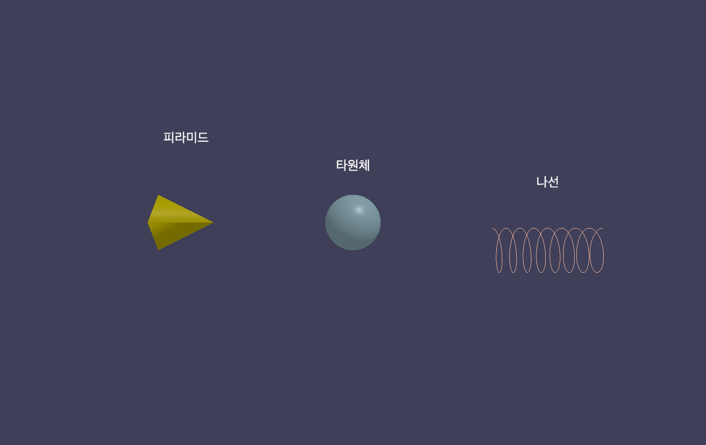 | [새 도형 모음](../client/src/data/examples.js) — `/sandbox?example=showcase-shapes` | pyramid, ellipsoid, helix, label |
| 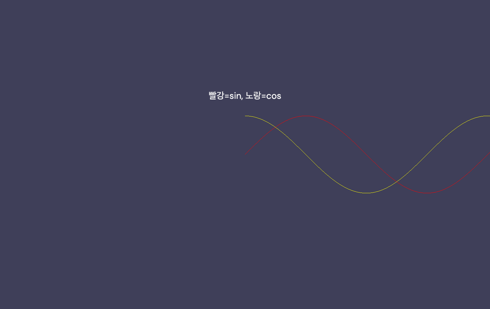 | [동적 곡선](../client/src/data/examples.js) — `/sandbox?example=showcase-curve` | curve.append() 누적 |
| 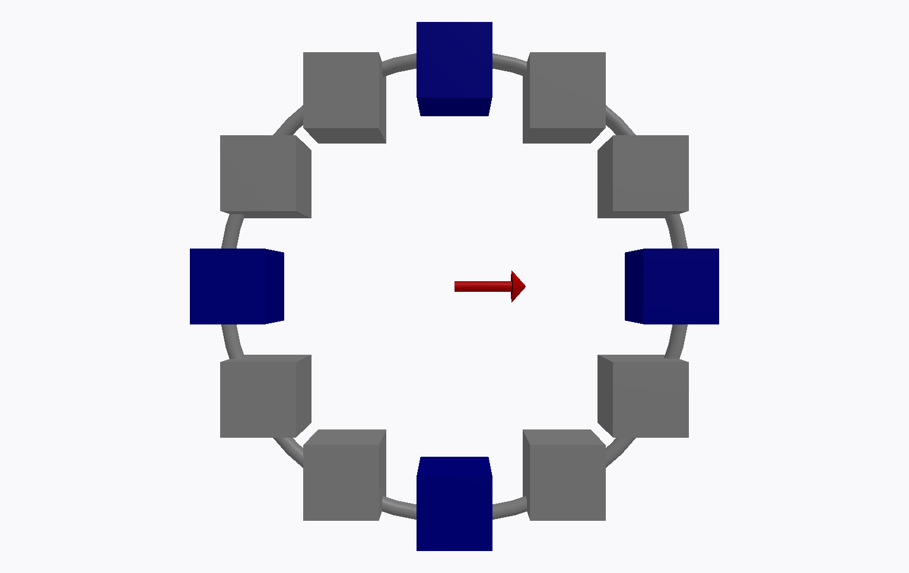 | [12지 시계](../client/src/data/examples.js) — `/sandbox?example=showcase-clone-rotate` | 객체 .clone(), vector.rotate() |

### 이벤트 + 위젯
| 미리보기 | 제목 | 핵심 기능 |
|---|---|---|
| 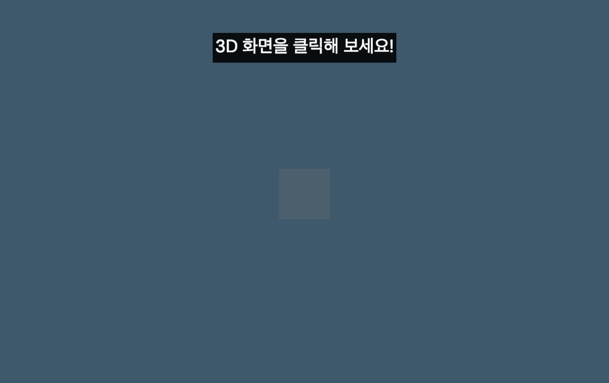 | [클릭으로 공 만들기](../client/src/data/examples.js) — `/sandbox?example=showcase-event-click` | scene.bind('click'), evt.pos |
| 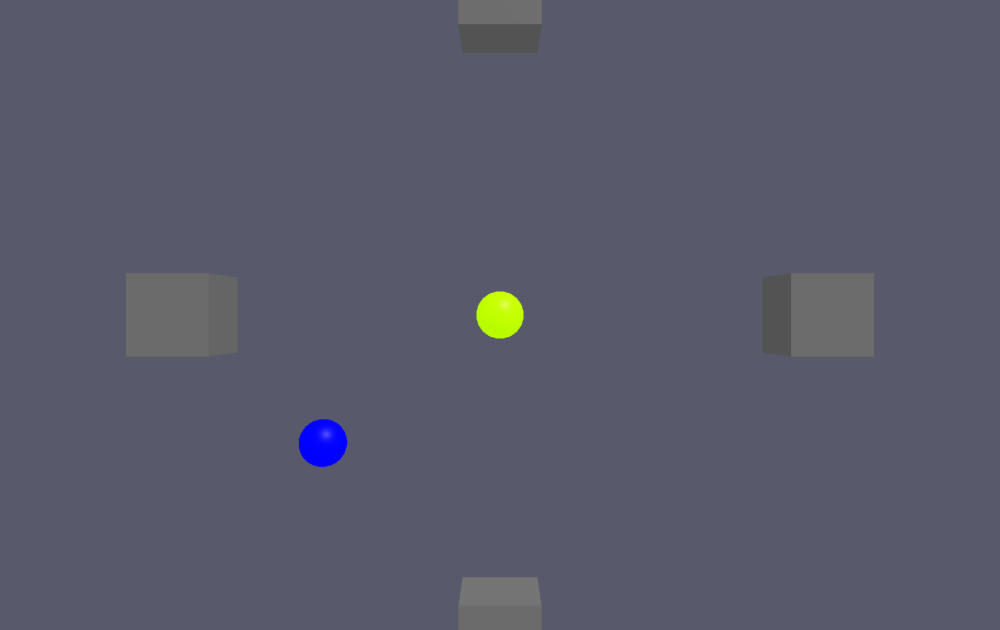 | [키보드로 공 조종](../client/src/data/examples.js) — `/sandbox?example=showcase-keyboard-bouncing` | scene.bind('keydown'), 벽 반사 |
| 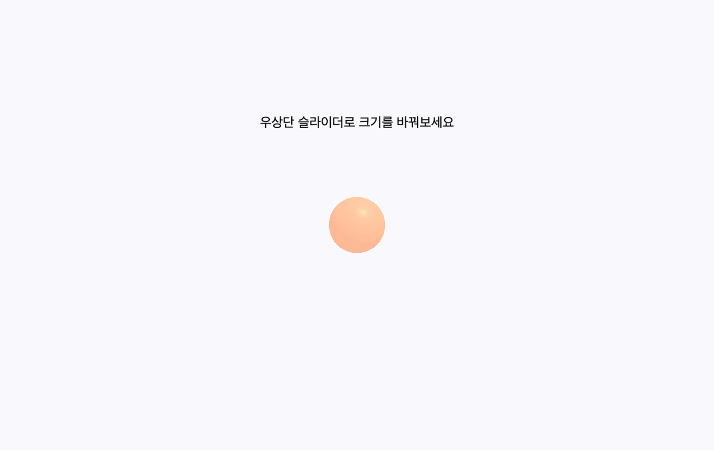 | [슬라이더로 공 크기 조절](../client/src/data/examples.js) — `/sandbox?example=showcase-slider-control` | slider, button 위젯 |

### 저수준 메시
| 미리보기 | 제목 | 핵심 기능 |
|---|---|---|
| 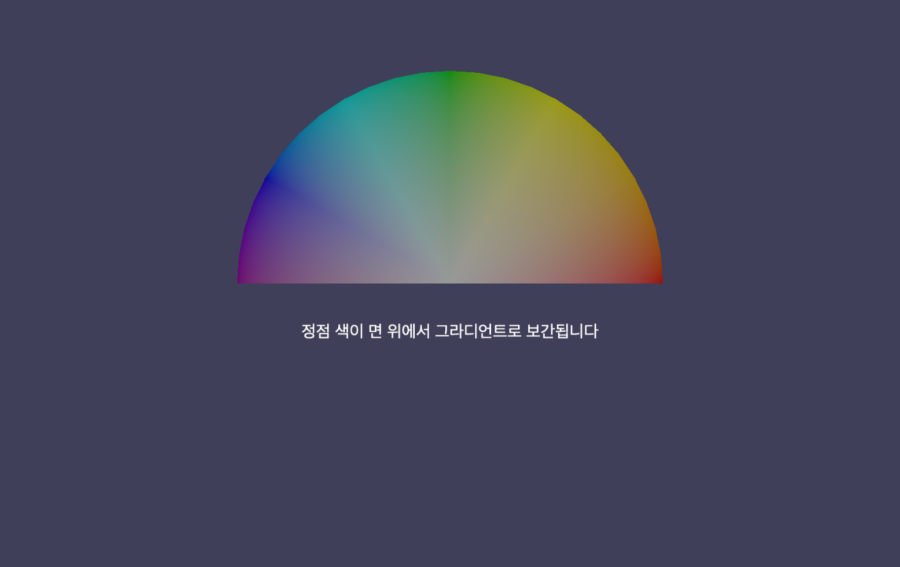 | [무지개 부채](../client/src/data/examples.js) — `/sandbox?example=showcase-vertex-rainbow` | vertex 정점 색상 그라디언트 |
| 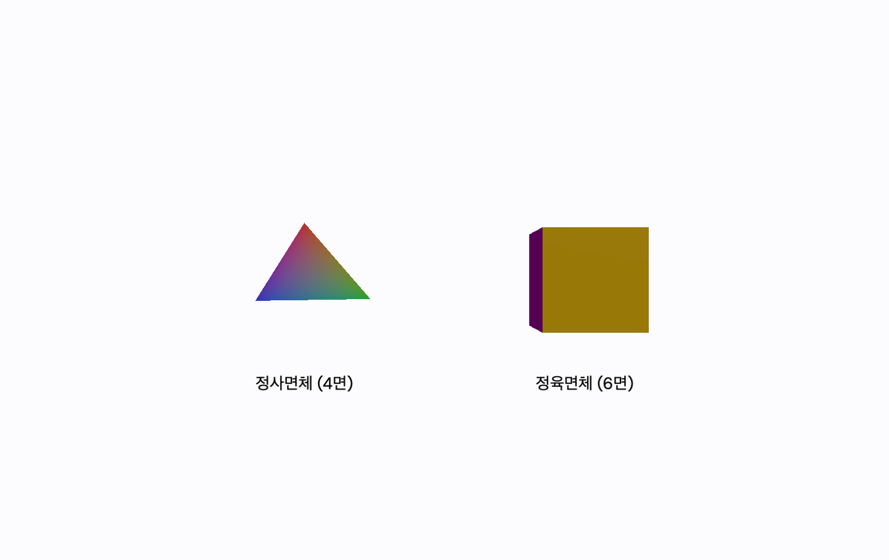 | [정사면체 + 정육면체](../client/src/data/examples.js) — `/sandbox?example=showcase-platonic-solids` | triangle, quad로 다면체 직접 구성 |
| 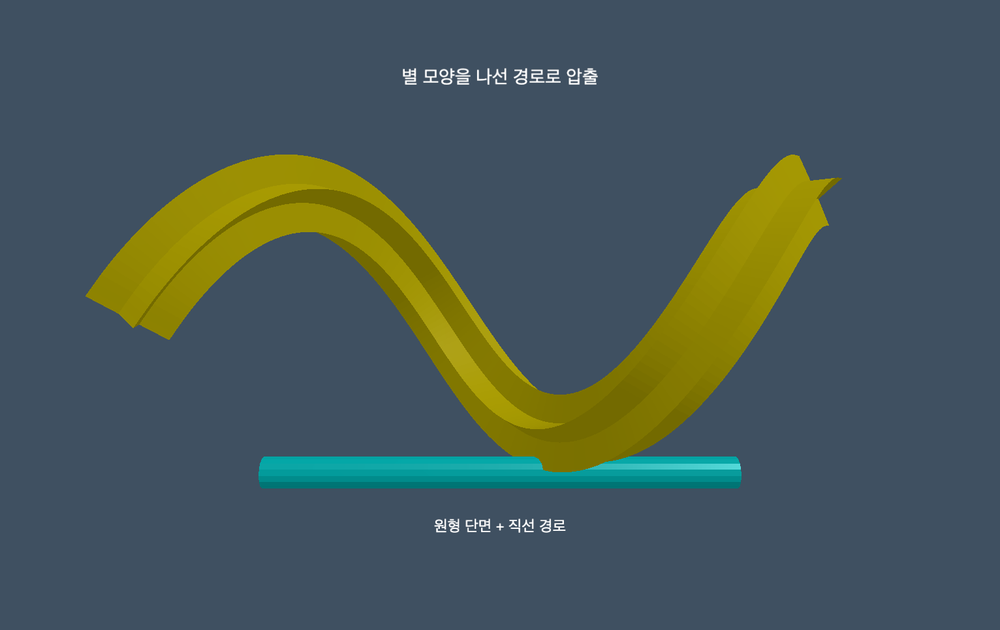 | [휘어진 튜브](../client/src/data/examples.js) — `/sandbox?example=showcase-extrusion-tube` | extrusion(path, shape) — 별 모양 압출 |

### 인터랙션 + 데이터
| 미리보기 | 제목 | 핵심 기능 |
|---|---|---|
| 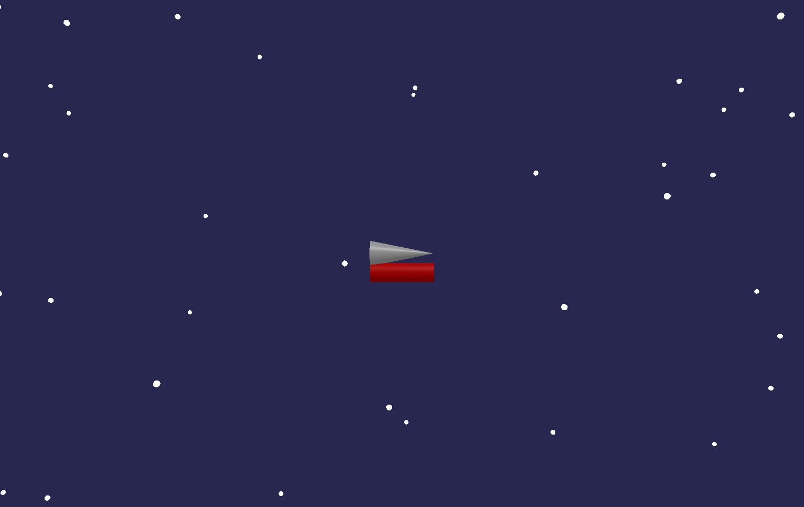 | [우주선 조종](../client/src/data/examples.js) — `/sandbox?example=showcase-keysdown-spaceship` | keysdown() 다중 키 동시 입력 |
| 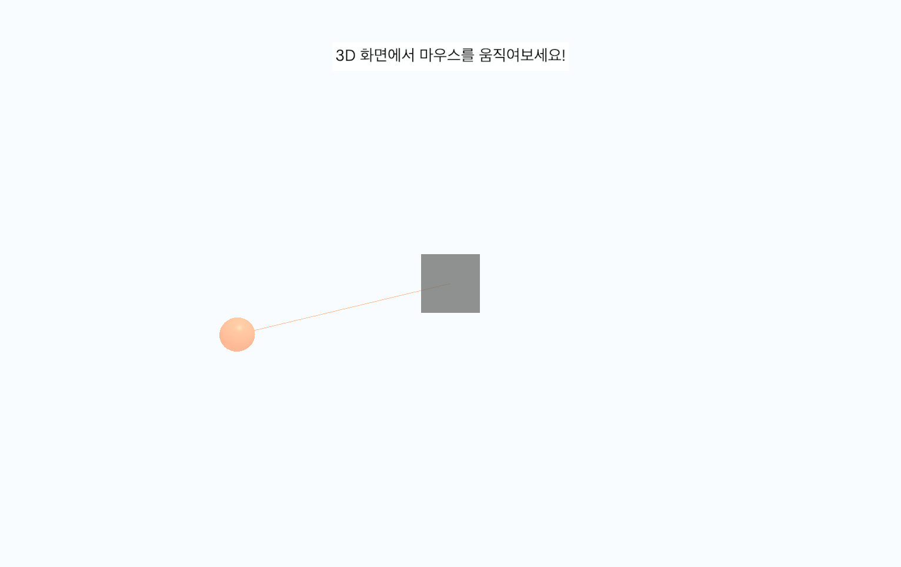 | [마우스 따라다니기](../client/src/data/examples.js) — `/sandbox?example=showcase-mouse-follow` | scene.mouse.pos 폴링 + 보간 |
| 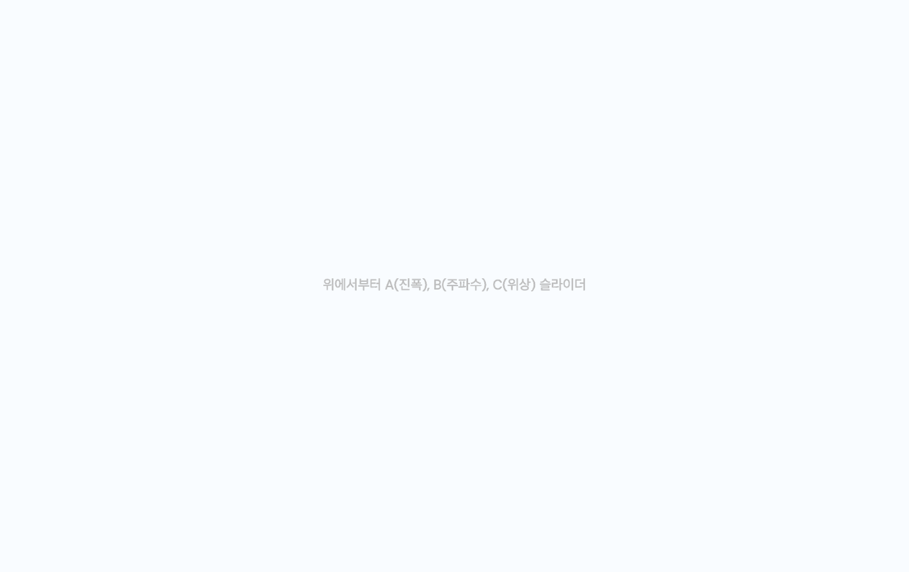 | [함수 그래프 조절](../client/src/data/examples.js) — `/sandbox?example=showcase-graph-functions` | slider 3개 + gcurve 실시간 갱신 |
| 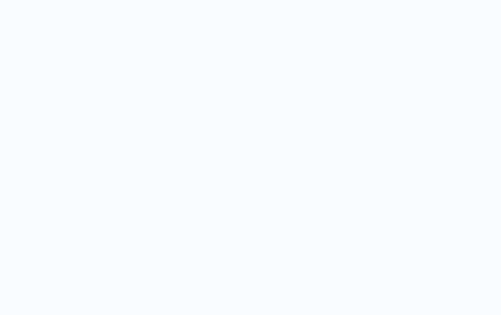 | [산점도 + 회귀선](../client/src/data/examples.js) — `/sandbox?example=showcase-scatter-regression` | gdots + gcurve, 최소제곱 회귀 |
| 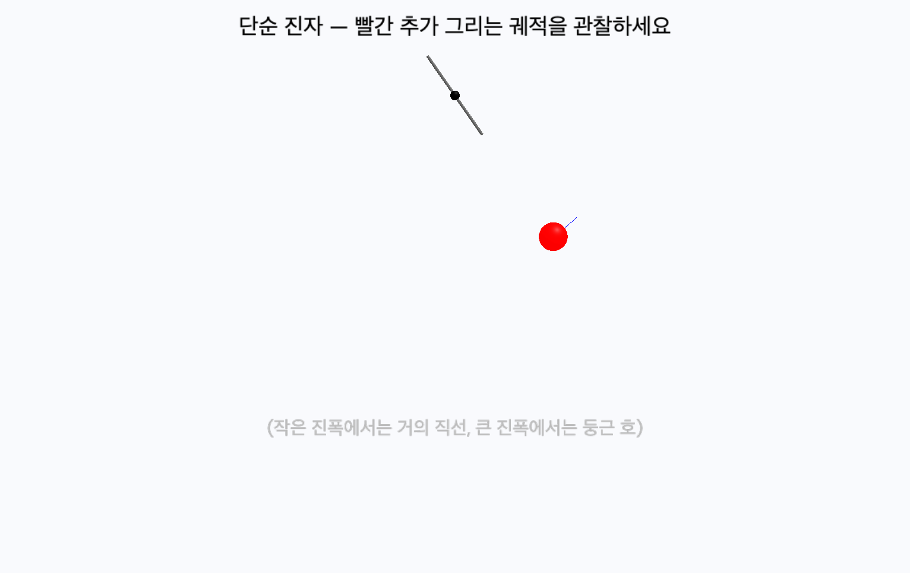 | [진자 운동 + 궤적](../client/src/data/examples.js) — `/sandbox?example=showcase-pendulum-trail` | attach_trail, Euler 적분 물리 |

> **링크 사용법**: 배포된 사이트에서 `https://your-domain/sandbox?example=showcase-shapes` 처럼 사용하면 해당 예제가 에디터에 자동으로 로드됩니다. 학생들에게 특정 예제를 직접 공유할 때 유용합니다.

---

---

## vector / vec

3D 벡터. `vector`와 `vec`은 동일합니다.

```python
v = vector(1, 2, 3)
v = vec(1, 2, 3)        # 별칭
v.x, v.y, v.z
v.mag                   # 크기
v.mag2                  # 크기 제곱
v.hat                   # 단위 벡터
v.to_list()             # [x, y, z]
v.clone()               # 복제

a + b, a - b, s * v, v / s, -v   # 산술 연산
a.dot(b)                          # 내적
a.cross(b)                        # 외적
a.proj(b)                         # b 방향으로 투영한 벡터
a.comp(b)                         # b 방향 스칼라 성분
a.diff_angle(b)                   # 두 벡터 사이 각(라디안)
a.rotate(angle, axis=...)         # axis 축으로 회전한 새 벡터
v.norm()                          # v.hat과 같음
v.equals(w)                       # v == w와 같음
vector.random()                   # 각 성분이 -1~1인 난수 벡터
```

전역 함수: `mag(v)`, `mag2(v)`, `hat(v)`, `dot(a,b)`, `cross(a,b)`, `norm(v)`, `proj(a,b)`, `comp(a,b)`, `diff_angle(a,b)`, `rotate(v, angle=, axis=)` (3D 객체를 넣으면 그 자리에서 회전).

### 수학 이름 (GlowScript와 같음)

`from vpython import *` 뒤에 `sin`, `cos`, `tan`, `sqrt`, `exp`, `log`, `pi`, `e` 등 `math` 모듈의 공개 이름을 바로 사용할 수 있다. 그 밖에 다음을 제공한다.

```python
random()                 # 0 이상 1 미만 난수. random.randint(1, 6)처럼 random 모듈 함수도 그대로 된다
arange(start, stop, step)   # 목록 반환
sign(x)                  # 1, -1, 0
combin(n, k)             # 조합의 수
clock(), msclock()       # 경과 시간 (초, 밀리초)
print_options(digits=3)  # 벡터 출력 자릿수
```

---

## color / 색상

30색 팔레트. 영문 속성과 한글 키 모두 지원합니다.

```python
color.red, color.green, color.blue, ...
색상['빨강'], 색상['초록'], 색상['파랑']
무지개[0]   # rainbow 팔레트
```

---

## 3D 객체

모든 객체는 공통 속성과 메서드를 가집니다.

### 공통 속성

```python
obj.pos       # vector
obj.color     # vector (RGB 0~1)
obj.visible   # bool
obj.opacity   # 0~1
obj.emissive  # bool — 자체 발광
```

axis가 있는 객체(`cylinder`, `arrow`, `cone`, `pyramid`, `helix`)는 `obj.axis`로 방향을 갖습니다.

`cylinder`, `cone`, `arrow`, `helix`의 `obj.length`는 `axis`의 길이와 연동됩니다. `length`를 바꾸면 `axis`가 같은 방향으로 늘어나거나 줄어들고, 생성할 때 `length=`를 주면 그 길이가 됩니다. `cylinder`·`cone`의 `size`는 `vector(length, 2*radius, 2*radius)`, `sphere`의 `size`는 지름 벡터입니다. `ellipsoid`는 `length`, `height`, `width`로도 만들 수 있습니다.

`pos`에는 `vector`만 넣을 수 있습니다. 튜플을 넣으면 `TypeError`로 안내합니다.

### 공통 메서드

```python
obj.clone(**kwargs)
# 동일 속성으로 새 객체 생성. kwargs로 일부만 덮어쓰기.
ball2 = ball.clone(pos=vector(2, 0, 0))

obj.rotate(angle, axis=None, origin=None)
# origin 중심으로 axis 축으로 angle(라디안)만큼 회전.
# origin 미지정: 자기 위치(self.pos)
# axis 미지정: 객체 자신의 axis (GlowScript와 같음). axis가 없는 sphere·ring 등은 vector(0, 1, 0)
# axis 속성을 가진 객체는 그 방향도 함께 회전.

obj.attach_trail(color=None, retain=10000, type='curve', pps=0, radius=0, interval=1)
# 객체에 궤적을 부착. 이미 있으면 색/길이만 갱신. stop()/start()/clear()가 있는 손잡이를 돌려준다.
# type='points'면 점 궤적, interval=n이면 n번 움직일 때마다 한 점, pps=k면 초당 k점까지만.
# 함수형 attach_trail(obj, ...)과 attach_trail(함수, ...)도 있다 (아래 '부착물' 절).

obj.clear_trail()
# 누적된 궤적을 모두 지움.
```

`compound`·`extrusion`·`text`·`group`에도 `rotate()`가 있고, `compound`·`extrusion`·`text`는 `clone()`도 된다.

### 프리미티브

| 클래스 | 주요 인자 | 설명 |
|---|---|---|
| `sphere` | `pos`, `radius`, `color`, ... | 구 |
| `box` | `pos`, `size=vector(L,H,W)`, `color`, ... | 직육면체 |
| `cylinder` | `pos`, `radius`, `axis`, `color`, ... | 원기둥 |
| `arrow` | `pos`, `axis`, `shaftwidth`, `color`, ... | 화살표(축+촉) |
| `cone` | `pos`, `radius`, `axis`, `color`, ... | 원뿔 |
| `ring` | `pos`, `radius`, `thickness`, `color`, ... | 도넛(토러스) |
| `pyramid` | `pos`, `size=vector(L,H,W)`, `axis`, ... | 사각뿔 |
| `ellipsoid` | `pos`, `size=vector(W,H,D)`, ... | 타원체 |
| `helix` | `pos`, `axis`, `radius`, `length`, `coils`, `thickness` | 나선/스프링 |
| `label` | `pos`, `text`, `color`, `height`(픽셀), `background`, `border` | 항상 카메라를 향하는 2D 텍스트 라벨 |
| `text` | `pos`, `text`, `height`, `depth`, `align`, `billboard`, `axis`, `up`, `color` | 두께가 있는 3D 입체 글자 (아래 절) |
| `compound` / `frame` | `[obj, obj, ...]`, `pos`, `axis`, `up`, `color`, ... | 여러 객체를 하나로 묶기. `pos` 기본값은 부품들의 중심이고 지정하면 중심이 그 자리로 옮겨진다. `length`·`size`·`axis` 길이로 크기 조절, `rotate()`·`clone()`, `origin`(읽기 전용)·`world_to_compound()`·`compound_to_world()` |
| `group` | `pos`, `axis`, `up`, `visible` + `box(group=g)` | 하위 객체를 나중에 따로 바꿀 수 있는 묶음 (아래 절) |
| `extrusion` | `path`, `shape`, `pos`, `axis`, `color`, ... | 2D 단면을 경로를 따라 쓸어 만든 입체 (`shapes`·`paths` 절) |

### group — 하위 객체를 따로 바꿀 수 있는 묶음

```python
g = group()                                   # pos=, axis=, up=, visible= 지정 가능
body = box(group=g, pos=vector(0, 0, 0), size=vector(4, 1, 2), color=color.red)
head = sphere(group=g, pos=vector(2.5, 0.5, 0), radius=0.5)   # pos는 g.pos 기준 상대 위치
car = compound([...]).clone(pos=vector(0, 2, 0), group=g)    # compound·text·curve도 들어간다

g.pos = vector(-10, 0, 0)                     # 묶음 전체 이동 (g.pos.x += 0.1 도 된다)
g.rotate(angle=0.1, axis=vector(0, 1, 0))     # g.pos를 중심으로 회전 (origin= 으로 중심 지정). 하위 객체의 상대 pos·axis가 함께 돈다
g.visible = False                             # g.color·g.up도 하위 객체 모두에 적용된다
head.color = color.blue                       # compound와 달리 하위 객체를 나중에 바꿀 수 있다
print(len(g.objects)); g.group_to_world(head.pos); g.world_to_group(vector(0, 0, 0))
```

동작은 GlowScript `lib/glow/primitives.js`의 group을 따릅니다. 묶음은 위치만 가지며 회전은 하위 객체를 하나씩 world 좌표에서 돌린 뒤 상대 좌표로 되돌리는 방식이고, `g.axis`를 바꾸면 옛 axis에서 새 axis로 가는 회전을 같은 방식으로 적용합니다.

---

## 동적 곡선 / 점

### curve

3D 폴리라인. 점을 누적해 선을 그립니다. 점마다 색과 반지름을 줄 수 있습니다 (GlowScript와 같은 호출 형식).

```python
c = curve(color=color.red)
for i in range(100):
    c.append(vector(i*0.1, sin(i*0.1), 0))

c = curve(vector(0, 0, 0), vector(1, 0, 0))                 # 위치 인자로 점 여러 개
c = curve(pos=[vector(0, 0, 0), vector(1, 1, 0)], radius=0.05)
c = curve([{'pos': vector(0, 0, 0), 'color': color.red, 'radius': 0.1}, {'pos': vector(1, 0, 0)}])

c.append(pos=vector(2, 0, 0), color=color.cyan, radius=0.1)  # 점 하나에 색·반지름
c.append([vector(3, 0, 0), vector(4, 0, 0)])                 # 여러 점
c.npoints                                                    # 점 개수 (len(c)도 같다)
c.point(2)                                                   # {'pos', 'color', 'radius', 'visible'}
c.modify(2, pos=vector(9, 0, 0))                             # i번째 점 수정 (color=, radius=, x=, y=, z=)
c.pop(); c.shift(); c.slice(0, 3); c.splice(1, 2, vector(5, 5, 5))
c.rotate(angle=0.01, axis=vector(0, 1, 0))                   # 점 좌표는 두고 전체를 회전 (origin= 지정 가능)
c.origin = vector(0, 1, 0)                                   # 전체 이동 (c.pos와 같다)
c.color = color.green                                        # 모든 점의 색을 바꾼다
c.clear()
```

`radius`는 받아 두지만 현재 선은 1픽셀 굵기로 그립니다(점마다의 반지름은 `points`의 `size_units='world'`에서 크기로 쓰입니다).

### points

3D 점 집합. 호출 형식은 `curve`와 같습니다.

```python
p = points(color=color.yellow, size=8)          # size: 픽셀 크기
for x in range(-5, 6):
    p.append(vector(x, 0, 0))
p = points(pos=[{'pos': vector(0, 0, 0), 'radius': 0.05, 'color': color.red}], size_units='world')  # 월드 크기
```

---

## 조명

```python
local_light(pos=vector(2,3,1), color=color.white, intensity=1.0)
distant_light(direction=vector(0,-1,0), color=color.white, intensity=0.8)
```

## 부착물 — attach_trail / attach_light / attach_arrow

`rate()`·`sleep()`을 지날 때마다 갱신됩니다.

```python
h = attach_trail(ball, color=color.green, retain=100)     # 객체 궤적. h.stop() / h.start() / h.clear()
f = attach_trail(lambda: ball.pos + vector(0, 1, 0))     # 함수 값이 궤적이 된다 (rate()마다 한 점)
p = attach_trail(ball, type='points', pps=10, radius=0.05) # 점 궤적, 초당 10점까지
ball = sphere(make_trail=True, trail_type='points', interval=10)   # 생성 시 지정도 된다

L = attach_light(ball, offset=vector(0, 1, 0), color=color.green)  # 객체를 따라다니는 점광원
L.offset = vector(1, 0, 0); L.color = color.red; L.visible = False

attach_arrow(ball, 'velocity', scale=0.5)                 # 벡터 속성을 따라다니는 화살표
```

## canvas() — 캔버스 만들기

VPyLab은 3D 화면이 하나입니다. `canvas(**kw)`는 인자를 `scene`에 적용하고 `scene`을 돌려줍니다. 두 번째 호출부터는 같은 `scene`을 돌려주고 콘솔에 안내를 한 번 출력합니다.

```python
scene = canvas(width=600, height=300, background=color.white, title='제목', center=vector(0, 1, 0), range=5)
scene.width, scene.height         # 값은 기억하지만 화면 크기는 레이아웃이 정한다
scene.visible = False             # 3D 화면 전체 숨기기 (객체는 남는다)
for o in scene.objects: o.visible = False
scene.delete()                    # 3D 객체 모두 지우기 (위젯·그래프는 남는다)
canvas.get_selected() is scene    # True
scene.select()                    # 할 일 없음 (캔버스가 하나)
```

---

## scene 객체

씬 전역 제어.

```python
scene.background = color.black
scene.range = 5                      # 카메라 시야 반경 (MANUAL 모드 진입)
scene.center = vector(0, 0, 0)       # 카메라 타겟 중심
scene.autoscale = False              # True면 Auto-Fit 복귀
scene.title = "내 시뮬레이션"        # 3D 화면 위쪽 글자
scene.caption = "설명..."            # 3D 화면 아래쪽 글자
scene.width = 800                    # 값만 기억 (화면 크기는 배치가 정한다)
scene.height = 500
scene.objects                        # 보이는 3D 객체 목록
scene.camera.rotate(angle=0.1, axis=vector(0, 1, 0))   # 중심을 보는 채로 카메라 회전
```

`scene.align`, `scene.resizable`, `scene.caption_anchor`, `scene.title_anchor`는 GlowScript 코드가 멈추지 않도록 받기만 합니다.

> **참고**: `scene.range` / `scene.center`를 설정하면 자동 카메라(Auto-Fit/Follow)가 비활성화됩니다. `scene.autoscale = True` 또는 뷰 더블클릭으로 복귀할 수 있습니다.

전역 함수 `scene_background(color)`도 동일한 효과입니다.

---

## 시뮬레이션 제어

```python
await rate(60)        # 초당 60프레임. 코드 전처리기가 await를 자동 삽입
await sleep(0.5)      # 비동기 sleep
```

> 학생 코드의 `rate(...)` / `sleep(...)`은 자동으로 `await`가 붙도록 전처리됩니다.

---

## 사운드 / 음악

`play_sound`, `play_note`, `play_chord`, `play_sequence`, `play_sfx`, `start_bgm`, `stop_bgm`, `note`, `play_instrument`, 한글 별칭(`소리`, `음표`, `효과음`, `배경음악`, `배경음악정지`, `화음`, `악기`).

자세한 사용법은 [PROGRESS.md](../PROGRESS.md)의 사운드 섹션 참조.

---

## 차트 (3D 데이터 시각화)

`scatter3d`, `surface3d`, `line3d`, `bar3d` (한글: `산점도`, `표면그래프`, `선그래프`, `막대그래프`).

`scatter3d`는 `scatter3d(points)` 외에 `scatter3d(x목록, y목록, z목록, color=색)`으로도 부를 수 있다. `colors=`에는 `vector` 목록도 된다.

VPython의 `graph`/`gcurve` 시리즈와는 다른 자체 API입니다.

---

## 저수준 메시

### vertex / triangle / quad

`vertex`는 위치·색상을 가진 점. `triangle`/`quad`는 정점들로 면을 만듭니다.

```python
v0 = vertex(pos=vector(0, 0, 0), color=color.red)
v1 = vertex(pos=vector(1, 0, 0), color=color.green)
v2 = vertex(pos=vector(0, 1, 0), color=color.blue)
triangle(v0=v0, v1=v1, v2=v2)        # 그라디언트 삼각형

# quad는 4정점 (시계방향 권장)
quad(vs=[v0, v1, v2, vertex(pos=vector(1, 1, 0))])
```

### extrusion — 단면을 경로를 따라 쓸기

2D 단면(`shape`)을 3D 경로(`path`)를 따라 쓸어 입체를 만듭니다. 단면의 y축은 경로의 up(기본 `vector(0,1,0)`) 방향, x축은 `tangent × up` 방향(원 경로에서 바깥쪽)에 놓이고, 꺾이는 점에서는 각의 이등분면에 단면을 둡니다. 경로의 첫 점과 끝 점이 같으면 닫힌 고리로 잇고 끝면을 만들지 않습니다.

```python
ring = extrusion(path=paths.circle(radius=2), shape=shapes.rectangle(width=0.4, height=0.2))
tube = extrusion(path=[vector(0,0,0), vector(2,0,0)], shape=shapes.circle(radius=0.6, thickness=0.2),
                 pos=vector(-1, 1.7, 0), axis=vector(0, 0, 2), color=color.yellow, end_face_color=color.blue)
two = extrusion(path=paths.arc(radius=1.7, angle2=pi),
                shape=[[shapes.triangle(length=2), shapes.circle(pos=[0, .5], radius=0.2)],   # 고체 1 = 바깥 + 구멍
                       [shapes.rectangle(pos=[0, 1.8], width=1, height=0.3)]])                # 고체 2
conch = extrusion(path=spiral, shape=shapes.circle(radius=0.7, thickness=0.01),
                  color=[...점마다의 색...], scale=[...점마다의 배율...])
tube.rotate(angle=0.1, axis=vector(0, 1, 0)); tube.clone(pos=vector(3, 0, 0))

# 직접 만든 단면도 된다: [(x, y), ...]
star = [(0, 0.5), (0.15, 0.15), (0.5, 0.15), (0.2, -0.05), (0.3, -0.5), (0, -0.2), (-0.3, -0.5), (-0.2, -0.05), (-0.5, 0.15), (-0.15, 0.15)]
extrusion(path=[vector(t, 0, 0) for t in range(-3, 4)], shape=star, color=color.gold)
```

- `pos`: 기본값은 경로의 중심(경계 상자 중심). 지정하면 입체 전체가 그 위치로 옮겨집니다.
- `shape`: 점 목록 하나(외곽선), `[바깥, 구멍, ...]`(`shapes.circle(thickness=)`가 돌려주는 형식), 또는 고체 여러 개의 목록.
- `color`: 색 하나 또는 경로 점마다의 색 목록. `scale`: 숫자 또는 경로 점마다의 배율 목록.
- `start_face_color` / `end_face_color` / `show_start_face` / `show_end_face`: 열린 경로의 끝면.
- `twist`·`smooth`·`xscale`·`yscale`은 받아 두기만 합니다.

### shapes / paths — 단면과 경로 생성기

[vpython-jupyter](https://github.com/vpython/vpython-jupyter)의 `shapespaths.py`(MIT)를 그대로 가져왔으므로 인자 이름·기본값·결과가 VPython 7과 같습니다 ([shapes_and_paths 문서](https://www.glowscript.org/docs/VPythonDocs/shapes_and_paths.html)). `shapes.*`는 `[x, y]` 점 목록(닫힌 외곽선은 첫 점을 끝에 반복)을, `paths.*`는 xz 평면에 놓인 `vector` 목록을 돌려줍니다.

```python
shapes.rectangle(pos=[0,0], width=1, height=None, rotate=0, thickness=0, roundness=0, invert=False, scale=1, xscale=1, yscale=1)
shapes.circle(radius=0.5, np=64, angle1=0, angle2=2*pi, thickness=0)       # 부분 원은 부채꼴
shapes.arc(radius=0.5, angle1=0, angle2=2*pi, thickness=None)              # 띠 모양
shapes.ellipse(width=1, height=None)   shapes.line(pos=[0,0], width=1, height=None, np=2, thickness=None)
shapes.triangle(length=1)  shapes.pentagon(length=1)  shapes.hexagon(length=1)  shapes.octagon(length=1)
shapes.ngon(np=None, length=1)   shapes.star(radius=1, n=5, iradius=None)
shapes.cross(width=1, thickness=0.2)   shapes.trapezoid(width=2, height=1, top=None)
shapes.points(pos=[[x, y], ...])   shapes.gear(n=20, radius=1, phi=20, addendum=None, dedendum=None, fradius=None, bevel=0)
shapes.rackgear(n=30, radius=5, length=10*pi, ...)
# thickness를 주면 [바깥, 구멍]을 돌려준다 (rectangle·circle·ngon·star·trapezoid 등). roundness는 모서리를 둥글게.

paths.circle(pos=vector(0,0,0), radius=3, np=32, up=vector(0,1,0))   # 닫힌 경로 (첫 점 반복). VPython 7 기본값(radius=3, np=32)
paths.arc(radius=3, angle1=0, angle2=pi)                           # 열린 경로
paths.rectangle(width=6, height=None)  paths.pentagon(length=6)  paths.star(radius=3)  paths.cross(width=5, thickness=2)
paths.line(start=vector(0,0,0), end=vector(0,0,-1), np=2)         # 직선 경로
paths.pointlist(pos=[[x, y], ...])                                 # 직접 준 2D 점 목록을 xz 평면 경로로
```

`shapes.gear`는 원본의 인벌류트 톱니 생성기(ToothOutline·RackOutline)입니다. `shapes.text`(글자 단면)는 원본에도 없으므로 입체 글자는 `text()`를 사용합니다.

### text — 3D 입체 글자

```python
t = text(text='Hello', pos=vector(0, 0, 0), height=1, depth=0.2, align='center', color=color.yellow)
t.length, t.start, t.end, t.upper_left, t.upper_right, t.lower_left, t.lower_right, t.descender, t.vertical_spacing
t.length = 3                 # 가로로 늘리거나 줄인다 (만들 때는 지정할 수 없다)
t.text = 'Bye'; t.height = 2; t.depth = 0.5; t.billboard = True   # billboard: 항상 카메라를 향함
t.rotate(angle=0.3, axis=vector(0, 1, 0)); t.clone(pos=vector(0, 2, 0))
text(text='Car', group=g, depth=1, start_face_color=color.red)
```

- `pos`는 기준선 위치입니다(`align='left'`면 왼쪽 끝, `'center'`면 가운데, `'right'`면 오른쪽 끝). `axis` 방향으로 글이 흐르고 `up`이 글자의 위쪽입니다.
- 번들 글꼴(helvetiker)은 라틴 문자만 담고 있습니다. 한글 등 글꼴에 없는 글자가 있으면 콘솔에 안내를 한 번 출력하고 카메라를 향하는 2D 라벨로 표시합니다.
- 속성 이름·기본값·검사(`text` 필수, `size` 없음, `font`는 `'sans'`/`'serif'`만, 얇은 `depth`는 높이의 1%로)는 VPython 7(vpython-jupyter `vpython.py`, MIT)과 같고 `upper_left`·`start`·`end`·`vertical_spacing` 계산식도 거기서 가져왔습니다.
- `length`는 평균 글자 폭으로 어림한 값이며, `font='serif'`는 받아 두기만 합니다. `start_face_color`는 앞·뒷면에 함께 적용됩니다.
- 2D 화면 라벨은 `label()`입니다(`text`는 더 이상 `label`의 별칭이 아닙니다).

---

## 이벤트 시스템

### scene.bind / scene.mouse

```python
def on_click(evt):
    # evt.pos: 월드 좌표 (vector)
    # evt.pick: 클릭된 객체 id 또는 None
    sphere(pos=evt.pos, radius=0.2, color=color.red)

def on_key(evt):
    # evt.key: 'ArrowUp', 'a', ' ' 등
    print(f"눌린 키: {evt.key}")

scene.bind('click', on_click)
scene.bind('keydown', on_key)
scene.bind('mousedown mouseup mousemove', on_click)  # 공백 구분 다중

# 데코레이터 형태도 지원
@scene.bind('mousemove')
def trace(evt):
    print(evt.pos)

# 실행 중인 루프에서는 rate() 호출 시점에 이벤트가 처리됩니다.
# 코드 실행이 끝난 뒤에도 위젯/클릭 콜백은 계속 동작합니다.
while True:
    rate(30)
```

지원 이벤트: `click`, `mousedown`, `mouseup`, `mousemove`, `keydown`, `keyup`, `widget`(위젯 콜백).

`scene.mouse.pos` — 현재 마우스 위치(vector)를 폴링.
`scene.mouse.pick` — 현재 마우스 아래 객체 id 또는 `None`.
`scene.mouse.ray` — 카메라에서 마우스가 가리키는 점을 향하는 단위 벡터. `scene.mouse.camera`는 카메라 위치.
`scene.mouse.project(normal=vector(0,1,0), point=vector(0,0,0))` — 마우스 광선을 평면에 투영한 점(`d=`로 원점 거리 지정도 가능). 만나지 않으면 `None`.

```python
def drag(evt):
    p = scene.mouse.project(normal=vector(0, 0, 1), d=0)   # z=0 평면 위의 마우스 위치
    if p is not None:
        ball.pos = p
scene.bind('mousemove', drag)
```

### keysdown() — 다중 키 동시 입력 폴링

`scene.bind('keydown')`은 한 번 누를 때 한 번 호출되지만, 게임처럼 여러 키를 **동시에** 누르고 싶을 때는 `keysdown()`을 사용합니다. 현재 눌려있는 키 리스트를 반환합니다.

```python
ball = sphere(pos=vector(0,0,0), radius=0.3, color=color.lime)
v = vector(0, 0, 0)
while True:
    rate(60)
    keys = keysdown()
    if 'ArrowLeft'  in keys: v.x -= 0.01
    if 'ArrowRight' in keys: v.x += 0.01
    if 'ArrowUp'    in keys: v.y += 0.01
    if 'ArrowDown'  in keys: v.y -= 0.01
    if ' '          in keys: v = vector(0, 0, 0)  # Space로 정지
    ball.pos += v
```

> standalone HTML export에서는 빈 리스트만 반환합니다 (Worker 채널 의존).

---

## UI 위젯

브라우저 우상단 패널에 DOM 컨트롤로 렌더링됩니다.

```python
# 슬라이더 — bind 콜백은 evt.value로 값 전달
def on_slide(evt):
    ball.radius = evt.value
slider(text='크기', min=0.1, max=2.0, step=0.05, value=0.5, length=200, bind=on_slide)

# 버튼
def on_click(evt):
    print("눌림!")
button(text='시작', bind=on_click)

# 체크박스 / 라디오 / 메뉴 / 입력창
checkbox(text='궤적 표시', checked=True, bind=lambda e: print(e.value))
radio(text='빨강', name='c', value='red', checked=True, bind=lambda e: print(e.value))
menu(choices=['느림', '보통', '빠름'], selected='보통', bind=lambda e: print(e.value))
winput(prompt='속도', type='numeric', bind=lambda e: print(e.value))

# 모든 위젯은 .value로 현재값 읽기/쓰기 가능
# .disabled = True/False, .delete()로 제거
# menu: .selected, .index / winput: .text, .number (GlowScript 호환)

# wtext — 캡션 영역의 글자 (슬라이더 값 표시용). 3D 화면 아래 scene.caption 옆에 놓인다
w = wtext(text='0.50')
def on_slide(evt):
    w.text = f'{evt.value:.2f}'
wtext(text='제목 옆 글자', pos=scene.title_anchor)   # 제목 영역에 놓기
w.delete()
```

---

## 2D 그래프

```python
g = graph(title='속도 vs 시간', xtitle='t', ytitle='v',
          width=480, height=320)

# 4종 시리즈
v_curve = gcurve(graph=g, color=color.red, label='속도')
v_dots  = gdots(graph=g, color=color.blue, size=4)
bars_v  = gvbars(graph=g, color=color.green, width=0.5)

t = 0
while t < 10:
    rate(30)
    v = math.sin(t)
    v_curve.plot(t, v)
    v_dots.plot(t, v * 0.8)
    t += 0.1

# redraw할 때는 시리즈를 삭제하지 말고 점만 비웁니다.
v_curve.clear()
```

---

## 표준 VPython과의 차이점

### 카메라·조명 (GlowScript와 같은 의미)

- `scene.forward`, `scene.up`, `scene.fov`, `scene.range`, `scene.center`, `scene.autoscale`
- `scene.camera.pos`, `scene.camera.axis`, `scene.camera.follow(obj)`
- `scene.ambient`, `scene.lights` (빈 목록이면 기본 조명을 끔), `local_light`, `distant_light`
- `scene.title`, `scene.caption`, `scene.append_to_title()`, `scene.append_to_caption()` → 3D 화면 위·아래 글자
- `attach_arrow(obj, 'velocity', scale=1)` → `rate()`·`sleep()`마다 갱신되는 화살표
- `scene.range`는 화면의 짧은 변 방향으로 보이는 범위의 절반이다. 기본 시야각은 45도(GlowScript는 60도)이며 `scene.fov`로 바꿀 수 있다.
- `ball.pos.x += 0.1`처럼 벡터 성분만 바꿔도 화면에 반영된다 (pos, axis, size, up, color, scene.center 등). 같은 벡터를 다른 물체에 넣으면 복제되어 서로 영향을 주지 않는다.
- `color.gray(0.3)`처럼 밝기를 지정한 회색을 만들 수 있다. `color.hsv_to_rgb()`, `color.rgb_to_hsv()`로 색을 변환한다.
- `textures.rock`, `textures.wood_old`는 가장 가까운 프리셋으로 그린다. `bumpmaps.*`는 받기만 하고 그리지 않는다.
- `simple_sphere`는 `sphere`와 같다.

### 미지원 (현 시점)

- `scene.width` / `scene.height`로 실제 화면 크기 바꾸기 (값은 받지만 화면은 그대로), 여러 개의 `canvas()` (두 번째부터는 같은 `scene`)
- `text()`의 한글 글꼴 (라틴 문자만 입체, 그 밖은 2D 라벨로 대체), `shapes.text`
- `curve`의 `radius` 굵기 (선은 1픽셀), `compound.length`·`size`로 크기 바꾸기, `scene.mouse.alt/ctrl/shift`(항상 False)
- `extrusion`의 `twist`·`smooth`, 범프맵(`bumpmaps.*`는 받기만 함)

### standalone HTML export 시 주의

[utils/export-html.js](../client/src/utils/export-html.js)로 생성한 단일 HTML 파일에서는 다음이 동작하지 않습니다 (콘솔 경고 후 무시):

- UI 위젯 (`slider`, `button`, `wtext`, ...) — Worker 채널 의존
- 2D 그래프 (`graph`, `gcurve`, ...) — DOM 패널 의존
- 이벤트 (`scene.bind`, `scene.mouse`) — 양방향 채널 의존
- `group`, 3D `text`, 단면이 있는 `extrusion`, 점별 색 `curve` — 내보내기용 간이 렌더러가 아직 모른다

3D 객체와 사운드는 export에서도 모두 동작합니다.

### VPyLab만의 추가 기능

- 한글 API: `색상`, `음표`, `무지개`, `음계`, `악기`, `산점도`, `표면그래프` 등
- 30색 팔레트: 한글/영어 키 양방향 접근
- 자동 카메라 시스템: Auto-Fit / Smooth Follow / Manual 3-모드
- 자체 차트 API: `scatter3d`, `surface3d`, `line3d`, `bar3d`

---

## 예제

### clone과 rotate

```python
from vpython import *
import math

# 원형으로 12개 박스 배치
unit = box(pos=vector(3, 0, 0), size=vector(0.5, 0.5, 0.5), color=color.cyan)
for i in range(1, 12):
    angle = i * math.pi / 6
    new_pos = vector(3, 0, 0).rotate(angle, axis=vector(0, 1, 0))
    unit.clone(pos=new_pos, color=color.red.rotate(angle, axis=vector(0,1,0)))
```

### curve로 사인파 그리기

```python
from vpython import *
import math

c = curve(color=color.yellow, radius=0.05)
for i in range(200):
    x = i * 0.05
    c.append(vector(x, math.sin(x*2), 0))
```

### helix 스프링

```python
from vpython import *
spring = helix(
    pos=vector(0, 0, 0),
    axis=vector(1, 0, 0),
    radius=0.5,
    length=4,
    coils=10,
    thickness=0.05,
    color=color.silver,
)
```

### scene.range로 고정 시야

```python
from vpython import *
scene.center = vector(0, 0, 0)
scene.range = 8
sphere(pos=vector(0,0,0), radius=1, color=color.red)
# Auto-Fit 비활성화 — 카메라가 고정됨
```

### 라벨

```python
from vpython import *
ball = sphere(pos=vector(0,0,0), radius=0.5, color=color.blue)
label(pos=vector(0, 1.2, 0), text="공", height=20, color=color.white,
      background=color.black, border=2)
```
