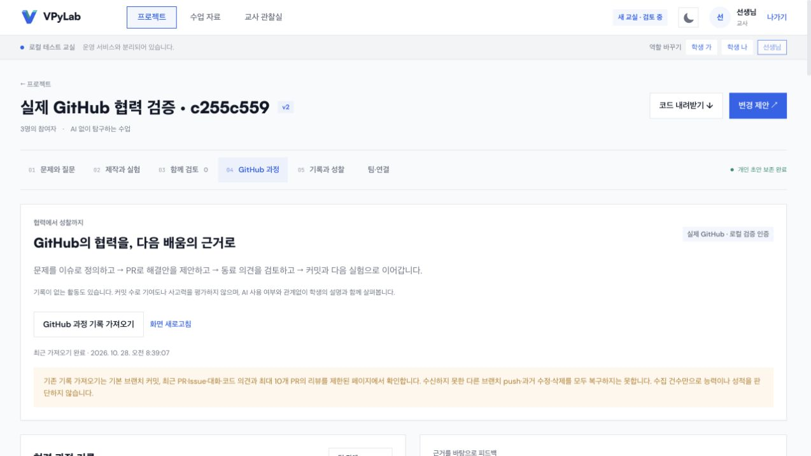

# GitHub 협업 흐름 재점검

2026-10-28 09:54 KST, `codex/classroom-v2`에서 기존 실검증 보고서·현재 코드·브라우저를 읽기 전용으로 대조했습니다. 이번 점검에서는 GitHub Issue·PR·댓글·병합을 새로 만들지 않았습니다. 운영 서비스는 변경하지 않았습니다.

## 판단

실제 비공개 저장소의 기술 연동은 검증됐습니다. 첫 연결부터 학생의 협업까지 자연스럽다는 최종 판정은 아직입니다.

- 기존 [실제 저장소 검증](../../CLASSROOM_V2_REAL_GITHUB_TEST_2026-10-28.md)은 질문→Issue, 확정 버전→PR, 리뷰·코드 의견 수집, 병합 후 가져오기, 충돌 차단, 학생별 근거·피드백 공개 범위 등 22개 확인 항목을 통과했습니다. 현재 CLI 로그인 한 계정과 합성 학생으로 수행한 결과입니다.
- 실제 GitHub App 설치·Webhook 수신·Supabase OAuth 신원 연결·서로 다른 실계정 승인과 조직 보호 규칙은 아직 실환경 검증하지 않았습니다.
- 질문 보내기(문제와 질문), PR 제출(팀·연결), 기록·피드백(GitHub 과정)이 여러 탭에 나뉩니다. 다음 행동을 연결하는 안내가 필요합니다.
- 교실의 로컬 변경 제안·검토와 GitHub PR·리뷰는 별개입니다. 같은 승인 절차로 오해하지 않게 더 명확한 안내가 필요합니다.
- GitHub에서 병합한 뒤 최신 코드 비교→개인 초안에서 실행→팀 확정 버전 반영을 수동으로 거칩니다. 초안 보존은 유지하되 다음 단계로 이어지는 안내가 필요합니다.
- 팀·연결의 작업 목록은 Issue에도 일반적인 변경 제안·PR 링크 문구를 표시할 수 있어 작업 종류별 표기가 필요합니다.

## 이번에 발견하고 수정한 로컬 화면 문제

과정 화면 진입 시 `Workspace.jsx` 동적 모듈 로딩 실패를 두 차례 재현했습니다. 의존성 요청에서 Monaco·Three.js·Supabase 사전 번들 5개 URL이 HTTP 504를 반환했습니다. 동시에 실행 중인 4043·4053 개발 서버가 같은 Vite 사전 번들 캐시를 사용하고 있었습니다.

`client/vite.classroom.config.js`의 `cacheDir`를 교실 포트별로 분리했습니다. 수정 후 소스 모듈 의존성 그래프의 228개 URL 요청에 실패가 없었고, 교실 빌드가 성공했습니다. 이 수는 요청 URL 수이며 기능 시험 수가 아닙니다.

브라우저를 다시 열어 기존 GitHub 과정 기록·원문 링크·학생 가의 개별 피드백·교사 개인 기록이 정상 표시됨을 확인했습니다. 이번 화면 확인에서는 기록 동기화·피드백 저장·외부 쓰기를 실행하지 않았습니다. 전체 자동 회귀 테스트를 다시 실행한 결과는 아닙니다.

